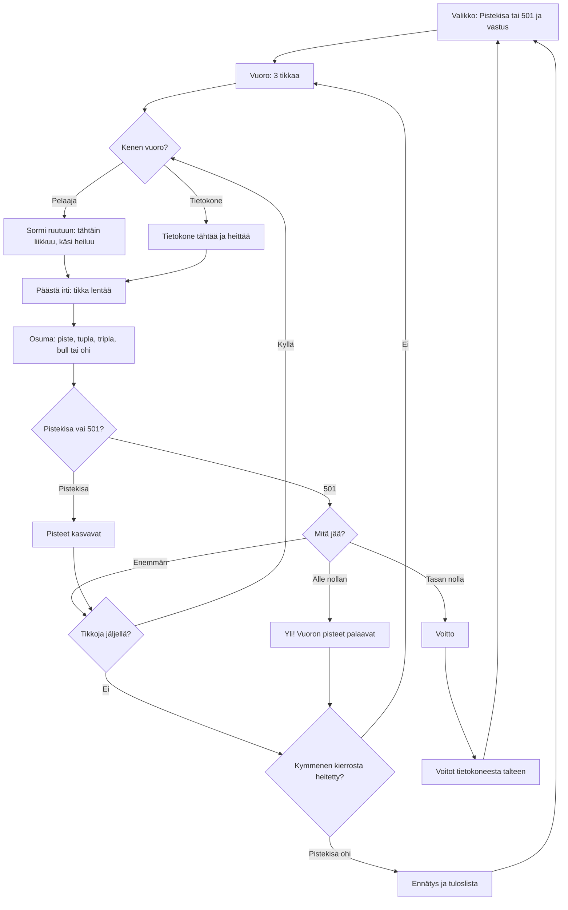

# Tikanheitto: one throw and one game

How Tikanheitto plays (v1). The player aims at a real-sized darts board by holding a finger on
the screen and moving the sight like a touchpad; the hand sways, more the longer they hold, and
letting go throws the dart. Pistekisa is ten rounds of three darts for points; 501 is played to
exactly nought against the computer or a friend on the same phone.

## Colours

- **blue**: what the player sees and does
- **violet**: the computer's turn
- **amber**: a check that decides the path
- **teal**: where the dart lands and the points
- **rose**: a bust in 501
- **green**: a won game or a record

## Boxes

- **Valikko: Pistekisa tai 501 ja vastus**: `showMenu()` in `games/tikka/v1/index.html`. The opponent for 501 (Helppo, Keskitaso, Kova or Kaveri) is saved as `ai-pelit:tikka:vastus`; the menu shows the record (`ennatys`) and wins against the computer (`voitot`).
- **Vuoro: 3 tikkaa**: `startTurn()` clears the board, gives three darts and puts the player's sight back where they last let go.
- **Sormi ruutuun: tähtäin liikkuu, käsi heiluu**: the pointer handlers move `aim` (millimetres from the bull) by the finger's movement, so the finger never covers what it aims at. `sway()` adds the hand's sway: about 5 mm at first, growing after 1.4 s of holding up to 25 mm, and the sight turns orange.
- **Tietokone tähtää ja heittää**: `botTarget()` picks T20 while far from nought and a finishing single, double, triple or bull near it; `step()` glides the sight there and throws with a scatter of 30, 17 or 9 mm (`AIM_SIGMA`) by level.
- **Päästä irti: tikka lentää**: `letGo()` throws at the sight plus the sway and a 2.5 mm scatter; a touch shorter than 0.12 s does not throw. `throwAt()` flies the dart for 0.28 s.
- **Osuma: piste, tupla, tripla, bull tai ohi**: `scoreAt()` scores a point on a real board's sizes: bull 50, outer bull 25, triple ring 99–107 mm, double ring 162–170 mm, numbers in the standard order from 20 at the top.
- **Yli! Vuoron pisteet palaavat**: in 501 a dart that would go under nought ends the turn and puts the score back where the turn started. No double is needed to finish.
- **Ennätys ja tuloslista**: `finish()` saves the best Pistekisa as `ennatys` and sends it with `AiPelitScores.submit()` (`public/scores.js` and `server/api.js`, `GAMES.tikka`, the `main` list).
- **Voitot tietokoneesta talteen**: a win against the computer adds one to `voitot`; a game with a friend counts for neither.
