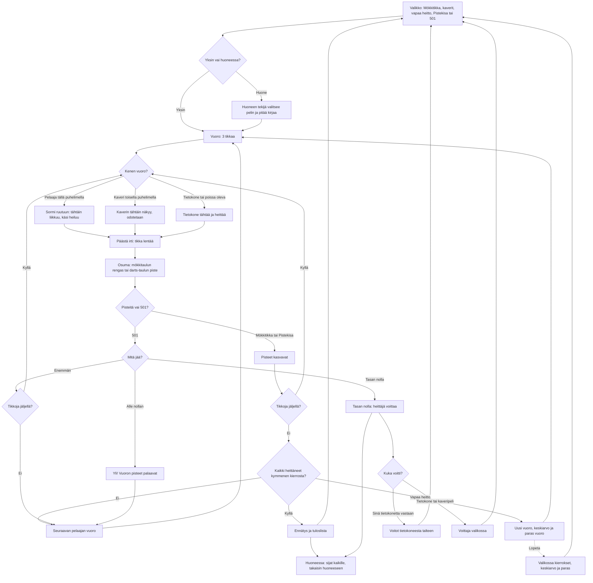

# Tikanheitto: one throw and one game

How Tikanheitto plays (v1 to v3). The player aims by holding a finger on the screen and moving
the sight like a touchpad; the hand sways, more the longer they hold, and letting go throws the
dart. From v2 the first mode is Mökkitikka on the Finnish cottage board (10 in the middle, ten
rounds of three darts), and friends can play together, one phone each, in a room; Pistekisa and
501 on the darts board stay. From v3 Vapaa heitto throws on either board with no computer and
no end, until the player taps Lopeta.

## Colours

- **blue**: what the player sees and does
- **violet**: someone else throwing: the computer, or a friend on another phone
- **amber**: a check that decides the path
- **teal**: where the dart lands, the points, and the phone that keeps them
- **rose**: a bust in 501
- **green**: a won game, a record or the results

## Boxes

- **Valikko: Mökkitikka, kaverit, vapaa heitto, Pistekisa tai 501**: `showMenu()` in `games/tikka/v3/index.html` (v2: `games/tikka/v2/index.html`, without Vapaa heitto; v1: `games/tikka/v1/index.html`, without Mökkitikka and rooms). Mökkitikka is the big first button; "👥 Pelaa kavereiden kanssa" opens the room (`AiPelitRooms.open()`); "Vapaa heitto, ilman tietokonetta" has Mökkitaulu and Darts-taulu (the last one picked is saved as `ai-pelit:tikka:vapaa`); Pistekisa, 501 and the 501 opponent (Helppo, Keskitaso, Kova or Kaveri on the same phone, saved as `ai-pelit:tikka:vastus`) sit under "Darts-taulu". The menu shows the records (`mokki`, `ennatys`) and wins against the computer (`voitot`).
- **Yksin vai huoneessa?**: `newGame()` starts a game on this phone alone; `R.on('start')` starts one in a room (`public/rooms.js`, 2 to 5 phones).
- **Huoneen tekijä valitsee pelin ja pitää kirjaa**: `roomControls()` shows the host Mökkitikka or 501 under the players (saved as `huonepeli`); the others see who picks. The host keeps the score: a guest sends its throws (`th`), and the host sends each dart's flight (`f`) and the whole game after every change (`g`, `state()` and `adopt()`). A phone that reloads gets the game again (`R.on('hello')`).
- **Vuoro: 3 tikkaa**: `startTurn()` clears the board, gives three darts and puts the player's sight back where they last let go.
- **Sormi ruutuun: tähtäin liikkuu, käsi heiluu**: the pointer handlers move `aim` (millimetres from the middle) by the finger's movement, so the finger never covers what it aims at. `sway()` adds the hand's sway: about 5 mm at first, growing after 1.4 s of holding up to 25 mm, and the sight turns orange. Only the phone whose turn it is can throw (`mine()`).
- **Kaverin tähtäin näkyy, odotetaan**: whoever throws sends where they aim ten times a second (`a`), so every phone sees the sight move in that player's colour, with "Vuorossa: <nimi>" at the bottom.
- **Tietokone tai poissa oleva**: `botTarget()` aims at the 10 in Mökkitikka, the triple 20 in Pistekisa, and T20 or a finish in 501; `step()` glides the sight there and throws with a scatter of 30, 17 or 9 mm (`AIM_SIGMA`). In a room, the host's "Jatka ilman heitä" hands a phone that is away to the computer (`R.on('continue')`) until it is back (`R.on('back')`); while a phone is away the game waits (`R.paused`).
- **Päästä irti: tikka lentää**: `letGo()` and `release()` throw at the sight plus the sway and a 2.5 mm scatter; a touch shorter than 0.12 s does not throw. `throwAt()` flies the dart for 0.28 s.
- **Osuma: mökkitaulun rengas tai darts-taulun piste**: `mokkiAt()` scores the cottage board as the Finnish rules give it: the 10 is 35 mm across and rings 9 to 1 are 17 mm wide each (341 mm in all), a dart on a line counts for the better ring. `dartsAt()` scores a real darts board: bull 50, outer bull 25, triple ring 99–107 mm, double ring 162–170 mm.
- **Kaikki heittäneet kymmenen kierrosta?**: `endTurn()` passes the turn on; a round is over when it comes back to the first player, and Mökkitikka and Pistekisa end after round 10.
- **Yli! Vuoron pisteet palaavat**: in 501 a dart that would go under nought ends the turn and puts the score back where the turn started. No double is needed to finish.
- **Ennätys ja tuloslista**: `record()` saves the best Mökkitikka as `mokki` and the best Pistekisa as `ennatys`, and sends it with `AiPelitScores.submit()` to its own list: `pickBoard()` picks `mokki` or `main` (`public/scores.js` and `server/api.js`, `GAMES.tikka`). In a room each phone saves and sends its own score once (`R.once()`).
- **Voitot tietokoneesta talteen**: only the player beating the computer adds one to `voitot`.
- **Voittaja valikossa**: the computer winning shows what the player had left; in a game with a friend on the same phone the menu names the winner, and neither counts as a win.
- **Huoneessa: sijat kaikille, takaisin huoneeseen**: `hostEnd()` ranks the players (most points, then most tens; in 501 the one at nought first, then the least left), sends it with `R.deliver()`, and every phone shows its place and the full list in the room (`netFinish()`, `R.backToRoom()`).
- **Uusi vuoro, keskiarvo ja paras vuoro**: in Vapaa heitto (`mode === 'vapaa'`, v3) `endTurn()` adds each finished turn to `freeTurns`, `freeSum` and `freeBest` and never ends the game; the panel shows the turn's points, the average (`freeAvg()`) and the best turn, with a Lopeta button (`#stop`). Nothing is saved or sent to a list.
- **Valikossa kierrokset, keskiarvo ja paras**: `stopBtn.onclick` stops at once (a turn not finished does not count) and the menu reads "Vapaa heitto: <n> kierrosta, keskiarvo <x> p, paras <y> p".
