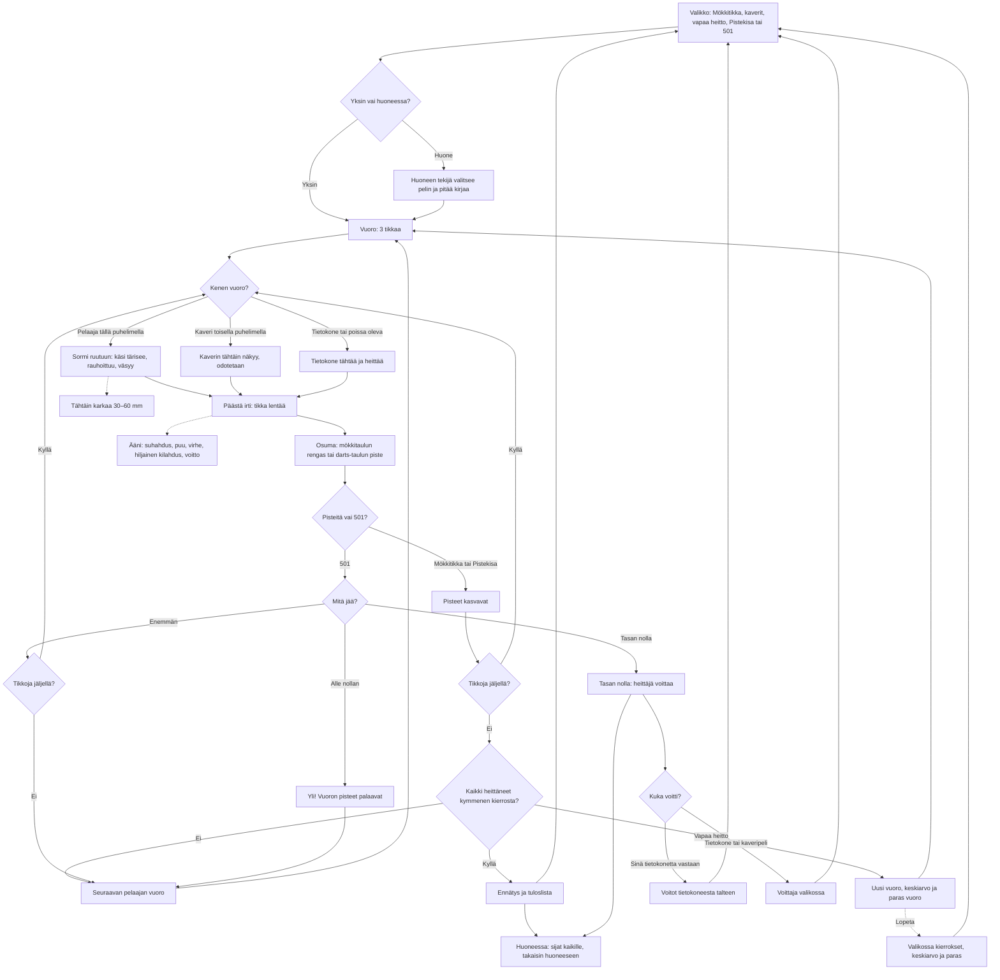

# Tikanheitto: one throw and one game

How Tikanheitto plays (v1 to v4). The player aims by holding a finger on the screen and moving
the sight like a touchpad; the hand sways, more the longer they hold, and letting go throws the
dart. From v2 the first mode is Mökkitikka on the Finnish cottage board (10 in the middle, ten
rounds of three darts), and friends can play together, one phone each, in a room; Pistekisa and
501 on the darts board stay. From v3 Vapaa heitto throws on either board with no computer and
no end, until the player taps Lopeta. v4 plays recorded sounds from the shared library
(`lib/aanet-2/`) instead of beeps.

Since #346 only each game's newest version folder is kept: a `games/<slug>/v<N>/` path below that is not the newest names a version that is history now (its files are in git's history, and the site sends its address to the newest), and what it says about that version is how it was.

v5 (#337, `aanet-4`) has no crowd: a turn of 30 is the quiet `onnistui` blip at 0.3 instead of a shouting crowd.

v6 (#355) loads `aanet-5`, where the sounds Eero still found too loud are swapped for softer ones he picked by ear, or play quieter (the winning and losing tunes); nothing else changed.

v7 (#400) makes the throw harder, because three players had a perfect 300 of 300 and tapping alone gave one: the hand shakes at first, is steady for a moment and then tires, the sight turns green while it is steady, and after each dart the sight comes back 30 to 60 mm off. The points no longer compare with v1 to v6's, so both point games start new bests and lists.

## Colours

- **blue**: what the player sees and does
- **violet**: someone else throwing: the computer, or a friend on another phone
- **amber**: a check that decides the path
- **teal**: where the dart lands, the points, the phone that keeps them, and the sounds
- **rose**: a bust in 501
- **green**: a won game, a record or the results

## Boxes

- **Valikko: Mökkitikka, kaverit, vapaa heitto, Pistekisa tai 501**: `showMenu()` in `games/tikka/v7/index.html` (history: v3 to v6 the same; v2 without Vapaa heitto; v1 without Mökkitikka and rooms). Mökkitikka is the big first button; "👥 Pelaa kavereiden kanssa" opens the room (`AiPelitRooms.open()`); "Vapaa heitto, ilman tietokonetta" has Mökkitaulu and Darts-taulu (the last one picked is saved as `ai-pelit:tikka:vapaa`); Pistekisa, 501 and the 501 opponent (Helppo, Keskitaso, Kova or Kaveri on the same phone, saved as `ai-pelit:tikka:vastus`) sit under "Darts-taulu". The menu shows the records of the harder throw (`mokki2`, `kisa2`) and wins against the computer (`voitot`). Through v6 it showed `mokki` and `ennatys`, which stay saved on the phone as history and are no longer shown here.
- **Yksin vai huoneessa?**: `newGame()` starts a game on this phone alone; `R.on('start')` starts one in a room (`public/rooms.js`, 2 to 5 phones).
- **Huoneen tekijä valitsee pelin ja pitää kirjaa**: `roomControls()` shows the host Mökkitikka or 501 under the players (saved as `huonepeli`); the others see who picks. The host keeps the score: a guest sends its throws (`th`), and the host sends each dart's flight (`f`) and the whole game after every change (`g`, `state()` and `adopt()`). A phone that reloads gets the game again (`R.on('hello')`).
- **Vuoro: 3 tikkaa**: `startTurn()` clears the board, gives three darts and puts the player's sight where their hand last came back to (`startAim()`); their very first one is 30 to 60 mm from the middle (v7; through v6 it started on the middle and stayed where they let go).
- **Sormi ruutuun: käsi tärisee, rauhoittuu, väsyy**: the pointer handlers move `aim` (millimetres from the middle) by the finger's movement, so the finger never covers what it aims at. `sway()` adds the hand's sway, `swayAmp()` its size from `HAND` (v7): 90 mm at first, settling to 28 mm by 1.0 s of holding, steady until 1.7 s (`isSteady()`, the sight is green and thicker), then growing up to 98 mm; the sight is orange when the hand is not steady. Through v6 it was 5 mm at first, growing after 1.4 s to 25 mm. Only the phone whose turn it is can throw (`mine()`).
- **Tähtäin karkaa 30–60 mm**: after each dart `letGo()` moves the thrower's sight with `offAim()` in a random direction and keeps it in `players[cur].aim`, on the phone that threw, so every dart has to be aimed again (v7).
- **Kaverin tähtäin näkyy, odotetaan**: whoever throws sends where they aim ten times a second (`a`), so every phone sees the sight move in that player's colour, with "Vuorossa: <nimi>" at the bottom.
- **Tietokone tai poissa oleva**: `botTarget()` aims at the 10 in Mökkitikka, the triple 20 in Pistekisa, and T20 or a finish in 501; `step()` glides the sight there and throws with a scatter of 30, 17 or 9 mm (`AIM_SIGMA`, unchanged in v7: a player who lets go at a random steady moment then wins about half against Keskitaso and rarely against Kova, one who also times the sight onto the target nearly always and about four times in ten). In a room, the host's "Jatka ilman heitä" hands a phone that is away to the computer (`R.on('continue')`) until it is back (`R.on('back')`); while a phone is away the game waits (`R.paused`).
- **Päästä irti: tikka lentää**: `letGo()` and `release()` throw at the sight plus the sway and a 4 mm scatter (`HAND.scatter`; 2.5 mm through v6); a touch shorter than 0.12 s does not throw. `throwAt()` flies the dart for 0.28 s.
- **Osuma: mökkitaulun rengas tai darts-taulun piste**: `mokkiAt()` scores the cottage board as the Finnish rules give it: the 10 is 35 mm across and rings 9 to 1 are 17 mm wide each (341 mm in all), a dart on a line counts for the better ring. `dartsAt()` scores a real darts board: bull 50, outer bull 25, triple ring 99–107 mm, double ring 162–170 mm.
- **Kaikki heittäneet kymmenen kierrosta?**: `endTurn()` passes the turn on; a round is over when it comes back to the first player, and Mökkitikka and Pistekisa end after round 10.
- **Yli! Vuoron pisteet palaavat**: in 501 a dart that would go under nought ends the turn and puts the score back where the turn started. No double is needed to finish.
- **Ennätys ja tuloslista**: `record()` saves the best Mökkitikka as `mokki2` and the best Pistekisa as `kisa2` (`bestKey()`, v7), and sends it with `AiPelitScores.submit()` to its own list: `pickBoard()` picks `mokki2` or `kisa2` (`public/scores.js` and `server/api.js`, `GAMES.tikka`). The easier throw's saves (`mokki`, `ennatys`) stay untouched, and its lists `mokki` and `main` stay on the game's page as "Vanha Mökkitikka" and "Vanha Pistekisa". In a room each phone saves and sends its own score once (`R.once()`). This game keeps its own score entry; the shared registry’s new `minigolf` entry (#340, lowest stroke total on `main`) does not change it. Kiekkoammunta v1 adds independent `trap` and `skeet` score entries (Trap first, N/25); this box’s existing behavior is unchanged. Frisbeegolf v1 adds its own `main` entry to these registries: lowest strokes against par wins, displayed as `E`, `−2` or `+5`; this box keeps its existing behavior.
- **Voitot tietokoneesta talteen**: only the player beating the computer adds one to `voitot`.
- **Voittaja valikossa**: the computer winning shows what the player had left; in a game with a friend on the same phone the menu names the winner, and neither counts as a win.
- **Huoneessa: sijat kaikille, takaisin huoneeseen**: `hostEnd()` ranks the players (most points, then most tens; in 501 the one at nought first, then the least left), sends it with `R.deliver()`, and every phone shows its place and the full list in the room (`netFinish()`, `R.backToRoom()`).
- **Uusi vuoro, keskiarvo ja paras vuoro**: in Vapaa heitto (`mode === 'vapaa'`, v3) `endTurn()` adds each finished turn to `freeTurns`, `freeSum` and `freeBest` and never ends the game; the panel shows the turn's points, the average (`freeAvg()`) and the best turn, with a Lopeta button (`#stop`). Nothing is saved or sent to a list.
- **Valikossa kierrokset, keskiarvo ja paras**: `stopBtn.onclick` stops at once (a turn not finished does not count) and the menu reads "Vapaa heitto: <n> kierrosta, keskiarvo <x> p, paras <y> p".
- **Ääni: suhahdus, puu, virhe, hiljainen kilahdus, voitto**: from v5 (#337) a turn of 30 plays `onnistui` at 0.3, not `yleiso`. Before it: v4 (#230) loads `lib/aanet-2/aanet.js` and `sound()` plays `suhahdus` when a dart flies (`throwAt()`), `puu` when it sticks in the board and a quiet, lower `puu` when it misses (`land()`, and on a guest's phone `step()`), `virhe` on a 501 bust, `yleiso` for a full turn (30 or 180, `endTurn()`, and on a guest when that banner arrives in `adopt()`) and `voitto` at the end (`endGame()`). Each falls back to v3's own beep when `AiPelitAanet.play()` returns false (the first open offline), and all of them do when `aanet.js` itself did not load.
