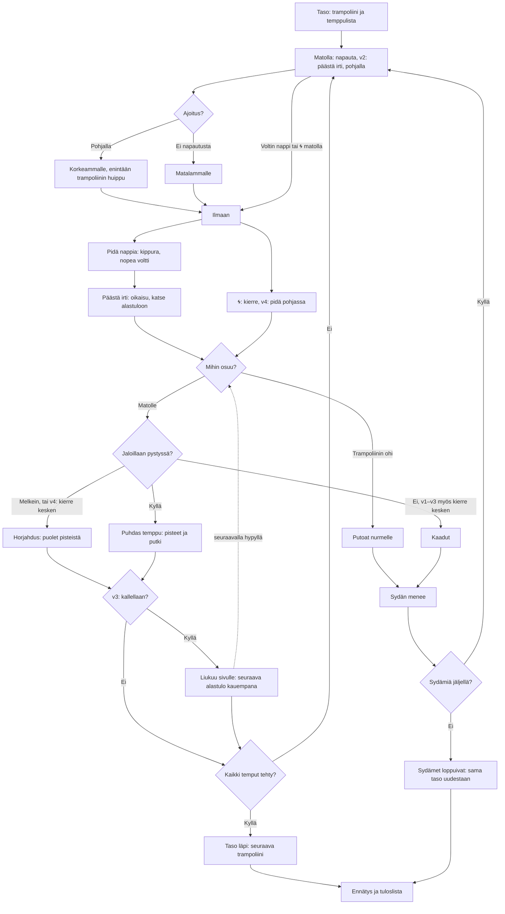

# Trampoliini: one bounce, from the mat to the landing

How one Trampoliini bounce plays (v1 to v4). The player pushes at the bottom of each bounce
to go higher (v1: a tap; v2 and v3: hold the screen to bend the knees and let go), holds a flip
button to spin tucked, lets go to stretch out and spot the landing, and taps 🌀 for a twist (from v4 a tap is a half twist, and held down it keeps twisting until let go). From
v3 a tilted landing slides the jumper sideways on the next bounce. Each level has its own size of trampoline and a list of tricks; the level is cleared when
every trick is done before three hearts run out.

From v6 (#158) the jumper wears the outfit picked under "👕 Asu" in the menu (`figure()` in `games/trampoliini/v6/index.html`; the picker is `asut.md`).

## Colours

- **blue**: what the player does
- **amber**: a check that decides what happens
- **teal**: the bounce itself
- **violet**: what the level asks
- **green**: a trick, a level or a record made
- **rose**: a fall, a lost heart, a go ended

## Boxes

- **Taso: trampoliini ja temppulista**: `LEVELS` and `levelOf()` in `games/trampoliini/v1/index.html`. Levels 1–5 go big garden trampoline with a net, small garden trampoline, mini trampoline, competition trampoline, giant trampoline (`TRAMPS`: each its own mat length `half`, top speed `vMax` and height); from level 6 they come round again with four tricks drawn from those the trampoline has air for (`needs()`, which already leaves time to stretch out; the mini trampoline has exactly five, so it gets four of them; tests check every level from 6 to 30 asks four different tricks, and land every trick of the first fifteen levels).
- **Matolla: napauta, v2: päästä irti, pohjalla**: `tap()`; each bounce spends 0.3 s on the mat (`mat()`), and a tap up to 0.12 s before landing still counts. From v2 (`games/trampoliini/v2/index.html`) the push is letting go: a finger on the screen bends the knees and keeps them bent (`squatDown()`, `bend`, `legBend()`), pressing the mat up to 30 % deeper, and letting go (`squatUp()`, only the same finger) is the tap's push, with a thump, the arms swinging down (`kick`) and a spring sound when it counts well. Held through a whole bounce, there is no push and the bounce dies down. The flip buttons work as in v1.
- **Ajoitus?**: `pumpQuality()`: within 0.05 s of the bottom is perfect; it fades to nothing 0.25 s away.
- **Korkeammalle, enintään trampoliinin huippu**: `takeoff()`: 90 % of the landing speed plus up to 2 m/s, never over the trampoline's `vMax`; without a tap 82 %, so the bounce dies down to a small hop.
- **Voltin nappi tai 🌀 matolla**: `press()` and `twistTap()` on the mat also count as the tap, and start the flip or twist from the take-off; a flip started from the mat carries you 0.25 m/s back or forward (`DRIFT`), which matters on the small trampolines.
- **Pidä nappia: kippura, nopea voltti**: `air()`: held, the jumper tucks and turns 1.4 times a second (`TUCK`).
- **Päästä irti: oikaisu, katse alastuloon**: `air()`: let go, the turn slows to at most 1.2 rad/s (`OPEN`) and eases onto the nearest upright ahead, or back onto one just passed.
- **🌀: kierre, v4: pidä pohjassa**: `twistTap()`: one full twist about the long axis, 1.6 a second (`TWIST`), up to three a jump. From v4 (`games/trampoliini/v4/index.html`) twists come in halves: `twistDown()` asks for half a twist more at once (a tap is a half twist, "Puolikierrehyppy"), and while 🌀 is held (`twistHeld`) `air()` keeps the target half a twist ahead for as long as it is held; `twistUp()` lets the half under way finish. 🌀 pressed in the last 0.12 s before the mat is for the next jump and does not spoil this landing; held through a landing, the next jump twists on (`takeoff()`). An odd number of halves lands you facing the other way (`J.face`): back and forward stay the jumper's own, so a back flip still drifts and slides behind you.
- **Trampoliinin ohi**: past the mat's end you fall to the grass; the big garden trampoline's net bounces you back instead.
- **v3: kallellaan?**: `land()` in `games/trampoliini/v3/index.html`: the tilt the jumper lands with (`wrap(J.a)`); leaning back is behind, forward is ahead. v1 and v2 have no such check.
- **Liukuu sivulle: seuraava alastulo kauempana**: v3 adds `-sin(tilt) × slideOf(T)` m/s sideways (see the landing box); a lean of 0.25 rad or more shows "← Liukuu taaksepäin" or "Liukuu eteenpäin →" (`SLIDE_SHOWN`), but only when you really go that way: off the middle the mat's pull can win, and then nothing shows. The next bounce carries you that far, so several leaning landings in a row can take you past the mat.
- **Jaloillaan pystyssä?**: `land()`: within 0.5 rad of upright, twist done and button let go is clean; within 1 rad is a wobble; otherwise a fall. From v3 (`games/trampoliini/v3/index.html`) the landing's tilt also moves you sideways: `land()` adds `-sin(tilt) × slideOf(T)` m/s (3 m/s per radian on the big garden trampoline, whose net keeps you on; without a net it is capped so the steepest clean lean, 0.5 rad, at full height carries you at most 45 % of the way to the edge in one bounce, and `takeoff()` then caps all sideways pushes together, the slide, a flip's drift and speed left over, to 30 % of the way per bounce), leaning back sends you back and forward sends you forward, and the mat pulls you back to the middle less than in v2 (30 % of the distance instead of 60 %). From v4 a twist still under way at the landing is a wobble that counts the halves nearly made, never a fall; only the lean decides a fall.
- **Puhdas temppu: pisteet ja putki**: `score()` names the trick from whole turns and twists (`trickName()`), gives `trickPoints()` with a 10 % bonus per trick in a row (at most double); a trick done again in the same go pays only what it beats its earlier best by (`paid`), so one go's points have a ceiling, and ticks off a matching trick on the list (+25).
- **Taso läpi: seuraava trampoliini**: `clearLevel()` and `finish()`: a bonus of 50 × level + 20 a heart left; the next level is saved as `ai-pelit:trampoliini:taso`.
- **Ennätys ja tuloslista**: `finish()` saves the best go (`ennatys`) and sends its points with `AiPelitScores.submit()`; the list is the most points first (`trampoliini` in `public/scores.js` and `server/api.js`, see `tuloslistat.md`).
