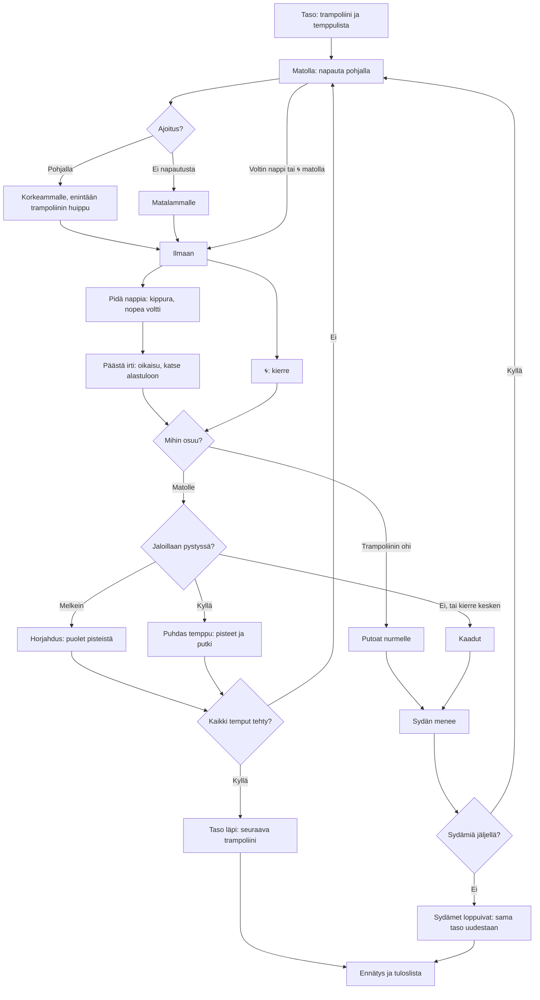

# Trampoliini: one bounce, from the mat to the landing

How one Trampoliini bounce plays (v1). The player taps at the bottom of each bounce to go higher,
holds a flip button to spin tucked, lets go to stretch out and spot the landing, and taps 🌀 for a
twist. Each level has its own size of trampoline and a list of tricks; the level is cleared when
every trick is done before three hearts run out.

## Colours

- **blue**: what the player does
- **amber**: a check that decides what happens
- **teal**: the bounce itself
- **violet**: what the level asks
- **green**: a trick, a level or a record made
- **rose**: a fall, a lost heart, a go ended

## Boxes

- **Taso: trampoliini ja temppulista**: `LEVELS` and `levelOf()` in `games/trampoliini/v1/index.html`. Levels 1–5 go big garden trampoline with a net, small garden trampoline, mini trampoline, competition trampoline, giant trampoline (`TRAMPS`: each its own mat length `half`, top speed `vMax` and height); from level 6 they come round again with four tricks drawn from those the trampoline has air for (`needs()`, which already leaves time to stretch out; the mini trampoline has exactly five, so it gets four of them; tests check every level from 6 to 30 asks four different tricks, and land every trick of the first fifteen levels).
- **Matolla: napauta pohjalla**: `tap()`; each bounce spends 0.3 s on the mat (`mat()`), and a tap up to 0.12 s before landing still counts.
- **Ajoitus?**: `pumpQuality()`: within 0.05 s of the bottom is perfect; it fades to nothing 0.25 s away.
- **Korkeammalle, enintään trampoliinin huippu**: `takeoff()`: 90 % of the landing speed plus up to 2 m/s, never over the trampoline's `vMax`; without a tap 82 %, so the bounce dies down to a small hop.
- **Voltin nappi tai 🌀 matolla**: `press()` and `twistTap()` on the mat also count as the tap, and start the flip or twist from the take-off; a flip started from the mat carries you 0.25 m/s back or forward (`DRIFT`), which matters on the small trampolines.
- **Pidä nappia: kippura, nopea voltti**: `air()`: held, the jumper tucks and turns 1.4 times a second (`TUCK`).
- **Päästä irti: oikaisu, katse alastuloon**: `air()`: let go, the turn slows to at most 1.2 rad/s (`OPEN`) and eases onto the nearest upright ahead, or back onto one just passed.
- **🌀: kierre**: `twistTap()`: one full twist about the long axis, 1.6 a second (`TWIST`), up to three a jump.
- **Trampoliinin ohi**: past the mat's end you fall to the grass; the big garden trampoline's net bounces you back instead.
- **Jaloillaan pystyssä?**: `land()`: within 0.5 rad of upright, twist done and button let go is clean; within 1 rad is a wobble; otherwise a fall.
- **Puhdas temppu: pisteet ja putki**: `score()` names the trick from whole turns and twists (`trickName()`), gives `trickPoints()` with a 10 % bonus per trick in a row (at most double); a trick done again in the same go pays only what it beats its earlier best by (`paid`), so one go's points have a ceiling, and ticks off a matching trick on the list (+25).
- **Taso läpi: seuraava trampoliini**: `clearLevel()` and `finish()`: a bonus of 50 × level + 20 a heart left; the next level is saved as `ai-pelit:trampoliini:taso`.
- **Ennätys ja tuloslista**: `finish()` saves the best go (`ennatys`) and sends its points with `AiPelitScores.submit()`; the list is the most points first (`trampoliini` in `public/scores.js` and `server/api.js`, see `tuloslistat.md`).
