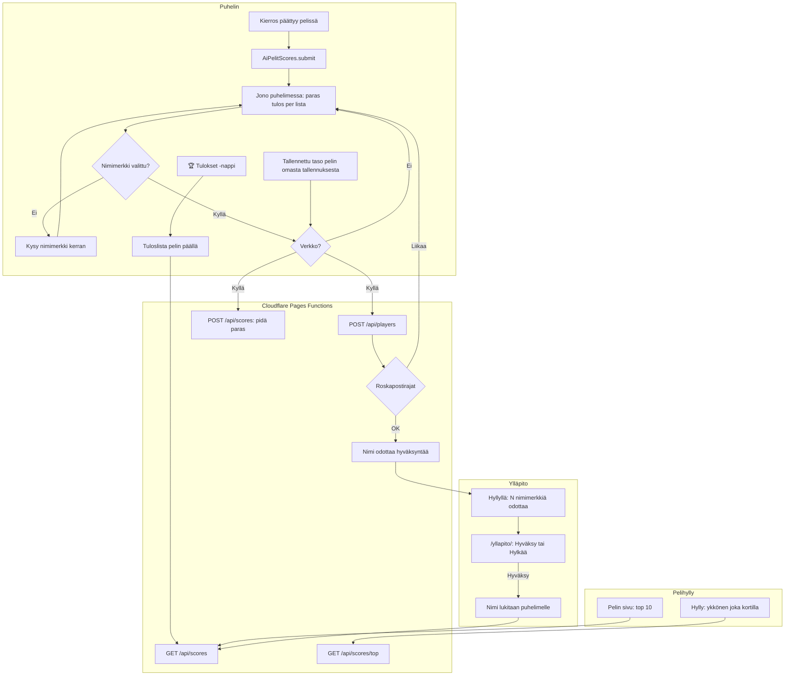

# Tuloslistat: high-score lists online

How a score gets from a game round onto the online list (#25), and how a nickname gets approved.
The game never waits for the network: a score waits on the phone until it can be sent. A
nickname shows on lists only after the admin approves it, and an approved name stays locked to
its phone. The play counts (#26) share `server/api.js` and `public/app.js` but not this
flow; they are drawn in `ai-pelit.md`.

## Colours

- **blue**: what the player sees and taps
- **amber**: a check that decides the path
- **teal**: where a score is kept and sent
- **violet**: the admin's part
- **green**: a name that shows on the lists

## Boxes

- **AiPelitScores.submit**: `public/scores.js`; a game version loads it with `data-game`, `data-order` and `data-corner`, and calls `submit(score)` when a round ends (Sormiskeitti v5, Voimistelu v3, Puhelinkoppi v2, Hiihto v2 and v3 (v3: classic times on `taso-N`, skating times on their own lists `luistelu-N`, both allowed by `GAMES` in `server/api.js`), Piano v1, Aitajuoksu v1 (v3: one list per race, 100 m hurdles still `main`, the others `200-aidat`, `400-aidat` and `<100|200|400>-tasainen`, allowed by `GAMES` in `server/api.js`), Kaaosrata v1, Trampoliini v1, Orava v1, Tikanheitto v1 (Pistekisa points only, no level; v2 also Mökkitikka on its own list `mokki`, chosen with `board()`), Skuutti v1 (the most points in one minute's run, no level), Keihäänheitto v1 (the longest throw of a meet in metres, level `taso`); Piano v2 and v3 also after every finished song). How each list reads lives in `GAMES` in `scores.js`, not in the games, so a change to a list needs no new version.
- **Jono puhelimessa: paras tulos per lista**: `localStorage` key `ai-pelit:_tulokset:jono`; only the best waiting score per list is kept, and `flush()` sends it on load, on `online`, and after each round. It leaves the queue only once the server took it (2xx), or answered 400 (a score it can never take).
- **Kysy nimimerkki kerran**: the first score on a phone opens the list with a name field; the name is one per phone for every game (`ai-pelit:_pelaaja:nimi`, with a random id in `ai-pelit:_pelaaja:id`).
- **POST /api/players**: `server/api.js` `setName()`, served by `functions/api/[[path]].js` on the D1 database (`migrations/`). The same function also forwards `/api/rooms/<CODE>` to the live game rooms, and `GET /api/rooms?game=` to their list of public rooms (#50), before it needs the database; neither touches scores (see `moninpeli.md`). A new or changed name is `pending`; it claims the name in `names` at once, so two phones asking together cannot both get it.
- **Roskapostirajat**: `setName()`: at most 5 new names a day per network (a salted hash, never the address) and none while 30 wait; a 429 leaves the name to be sent later. Each game accepts only its own lists (`GAMES` in `server/api.js`).
- **POST /api/scores: pidä paras**: `addScore()` keeps each player's best per list; no cheat checks (Eero's choice).
- **Tuloslista pelin päällä**: the overlay in `scores.js`: top 10 approved names with score and version, the player's own row, and its name's state (waiting, rejected, taken).
- **Hyllyllä: N nimimerkkiä odottaa**: `public/app.js` `showWaitingNames()`, only on a phone holding the admin key.
- **/yllapito/: Hyväksy tai Hylkää**: `public/yllapito/index.html` calls `/api/admin/players` with the `ADMIN_KEY` secret (set by `scripts/cloudflare_setup.py`, which also binds the rooms' `ROOMS`; see `moninpeli.md`). Each decision carries the name the admin saw; if the phone changed name meanwhile it is refused (409) and the page shows the new name.
- **Nimi lukitaan puhelimelle**: `adminDecide()` marks the name's row in `names` locked, so no other phone can take it, even after its owner changes name; rejecting the player frees it. Each name has one owner by the table's primary key (`claim()`), compared as `nameKey()`: Unicode NFKC, lower case, so 'ÄITI' is 'äiti'. A player whose freed name another phone took cannot be approved back into it.
- **Tallennettu taso pelin omasta tallennuksesta**: `levelOf()` in `scores.js` reads the level the game itself saves (`ai-pelit:sormiskeitti:level`, `ai-pelit:voimistelu:taso`, Hiihto's `taso` − 1 = courses passed, `ai-pelit:piano:taso` = the highest level reached, saved from level 1 on, `ai-pelit:aitajuoksu:taso`, `ai-pelit:kaaosrata:taso`, `ai-pelit:trampoliini:taso` and `ai-pelit:orava:taso` = the level the player is on; Aitajuoksu and Kaaosrata send their fastest time, lower is better) when it sends a score (not when the game hands it over: Sormiskeitti v5 saves its next level just after); the server keeps each player's highest (`scores.level`, `migrations/0005`), and every row shows the player's highest in the whole game, from any list (`GAME_LEVEL`), so Hiihto's course 1 list shows courses passed later. A round that beats neither the score nor the level is not sent (`ai-pelit:_tulokset:lahetetyt`, which records exactly the level each send carried), decided when sending; progress made while a send is on its way goes in one more send right after.
- **Hylly: ykkönen joka kortilla**: `loadTops()` in `public/app.js`: one request for every game's no. 1 (Hiihto: course 1; Tikanheitto: Mökkitikka, shown as "🏆 Mökkitikka: <nimi> · 
" from the game's named `lists` in `scores.js`); a no. 1 kept on the phone from a list the shelf no longer shows (Puhelinkoppi's withdrawn streak list) is skipped, kept on the phone for offline. A game in a shelf group (#153, Yleisurheilu) shows its no. 1 on its card on the group's page; the group's own card on the shelf shows none.
- **GET /api/scores/top**: `tops()` in `server/api.js`: each game's `main` list, or the one `GAMES` names `first` (Hiihto `taso-1`, Tikanheitto `mokki`).
- **Pelin sivu: top 10**: `scoreSection()` in `public/app.js`, with one button per named list for Tikanheitto (Mökkitikka first, then Pistekisa, from `lists` in `scores.js`), a ‹ Taso N › picker for Hiihto that reaches any course, not only those this phone has played (the classic lists; Hiihto v3's skating lists show in the game's own 🏆); rows drawn by `AiPelitScores.row()`.
