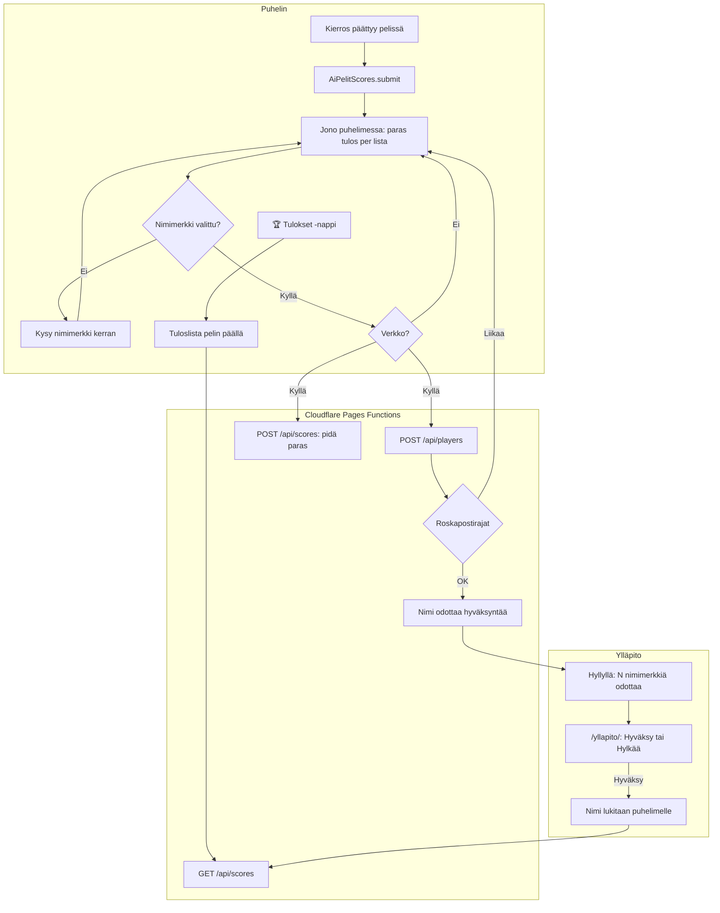

# Tuloslistat: high-score lists online

How a score gets from a game round onto the online list (#25), and how a nickname gets approved.
The game never waits for the network: a score waits on the phone until it can be sent. A
nickname shows on lists only after the admin approves it, and an approved name stays locked to
its phone.

## Colours

- **blue**: what the player sees and taps
- **amber**: a check that decides the path
- **teal**: where a score is kept and sent
- **violet**: the admin's part
- **green**: a name that shows on the lists

## Boxes

- **AiPelitScores.submit**: `public/scores.js`; a game version loads it with `data-game`, `data-order` and `data-corner`, and calls `submit(score)` when a round ends (Sormiskeitti v5, Voimistelu v3, Puhelinkoppi v2, Hiihto v2).
- **Jono puhelimessa: paras tulos per lista**: `localStorage` key `ai-pelit:_tulokset:jono`; only the best waiting score per list is kept, and `flush()` sends it on load, on `online`, and after each round.
- **Kysy nimimerkki kerran**: the first score on a phone opens the list with a name field; the name is one per phone for every game (`ai-pelit:_pelaaja:nimi`, with a random id in `ai-pelit:_pelaaja:id`).
- **POST /api/players**: `server/api.js` `setName()`, served by `functions/api/[[path]].js` on the D1 database (`migrations/`). A new or changed name is `pending`; it claims the name in `names` at once, so two phones asking together cannot both get it.
- **Roskapostirajat**: `setName()`: at most 5 new names a day per network (a salted hash, never the address) and none while 30 wait; a 429 leaves the name to be sent later. Each game accepts only its own lists (`GAMES` in `server/api.js`).
- **POST /api/scores: pidä paras**: `addScore()` keeps each player's best per list; no cheat checks (Eero's choice).
- **Tuloslista pelin päällä**: the overlay in `scores.js`: top 10 approved names with score and version, the player's own row, and its name's state (waiting, rejected, taken).
- **Hyllyllä: N nimimerkkiä odottaa**: `public/app.js` `showWaitingNames()`, only on a phone holding the admin key.
- **/yllapito/: Hyväksy tai Hylkää**: `public/yllapito/index.html` calls `/api/admin/players` with the `ADMIN_KEY` secret (set by `scripts/cloudflare_setup.py`).
- **Nimi lukitaan puhelimelle**: `adminDecide()` marks the name's row in `names` locked, so no other phone can take it, even after its owner changes name; rejecting the player frees it. Each name has one owner by the table's primary key (`claim()`), compared as `nameKey()`: Unicode NFKC, lower case, so 'ÄITI' is 'äiti'. A player whose freed name another phone took cannot be approved back into it.
