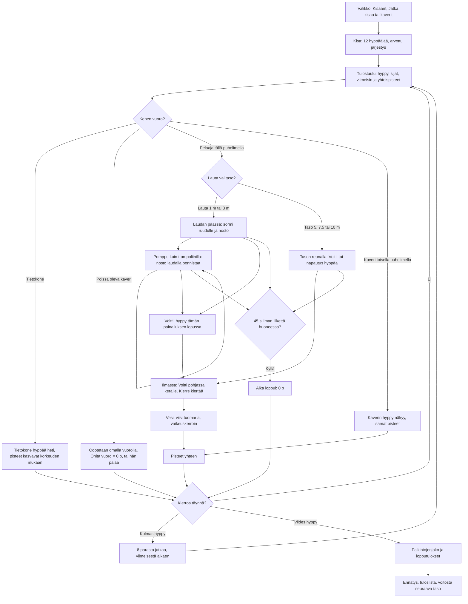

# Uimahyppy: one dive and one meet

How Uimahyppy plays (v1, #516). Seen from the side, the diver goes off a springboard or a platform
into the pool. Each of the five dives is from higher up: the 1 m and 3 m springboards, then the 5 m,
7.5 m and 10 m platforms, which have no board (Eero's choices on #516). On a board the diver bounces
as on Trampoliini: a finger down on the screen bends the knees, and lifting it pushes off; a push in
time bounces higher. "↻ Voltti" leaves the board (or the platform) and, held, tucks into somersaults;
"🌀 Kierre", held, twists. Opening before the water gives a clean entry. Five judges score each dive
and a diver's points are summed over the meet. The meet is the shared athletics library's
(`public/lib/yleisurheilu-11/kisa.js`): twelve divers alone against the computer, or 2–8 phones in a
room with the computer filling the rest; three dives, then the best eight dive two more.

## Colours

- **blue**: what the player sees and does
- **violet**: someone else diving: the computer, or a friend on another phone
- **amber**: a check that decides the path
- **teal**: the meet's rules and the judging
- **rose**: a dive lost to the clock
- **green**: the end of the meet and what it saves

## Boxes

- **Valikko: Kisaan!, Jatka kisaa tai kaverit**: `showMenu()` in `games/uimahyppy/v1/index.html`. "Kisaan!" starts a new meet at the player's level (`taso`); "Jatka kisaa" shows when a meet alone was left unfinished (`K.kept()`); "👥 Pelaa kavereiden kanssa" opens the room (`public/rooms.js`, 2–8 phones); "👕 Asu" picks the athletics events' shared outfit (`data-share="yleisurheilu"`, `asut.md`).
- **Kisa: 12 hyppääjää, arvottu järjestys**: `AiPelitKisa.meet()` in `public/lib/yleisurheilu-11/kisa.js` (see `yleisurheilu-kirjasto.md`) with the game's own format `points()`: `AiPelitKisa.rounds({ rounds: 5, cut: 3, final: 8 })` whose standings and board sum every dive (`F.total`, the board's right column "YHT."). Computer divers (`FOES`) fill the field to twelve, each with a skill around `base(level)` points a dive (30 at level 1, 4 more per level up to 62), spread by `spread` and `jitter`.
- **Tulostaulu: hyppy, sijat, viimeisin ja yhteispisteet**: the library's `K.drawBoard()`, shown for 3.5 s (`BOARD_T`) before each of the player's turns; alone a tap skips it.
- **Kenen vuoro?**: the library's turn order; `newTurn()` makes the turn each phone draws (`th`) and sets its height from the meet's round: `heightOf(round)` in `HEIGHTS` (1 m and 3 m with a board, then 5, 7.5 and 10 m without), `frameScene()` and the camera (`camY`, `camAim()`).
- **Tietokone hyppää heti, pisteet kasvavat korkeuden mukaan**: `cpuMark(t, c)`: the skill times the height's factor (`CPU_HEIGHT` 0.9, 1, 1.06, 1.14, 1.2, by `c.round`) plus a scatter of 7, never over the height's cap (`CPU_CAP` 63, 70, 74, 80, 80), at least 4; one dive in twenty (0.05) is flat on the water, 3–12 points. Each cap is a little under a player's best clean dive at that height (about 66, 74, 78, 84 and 84, simulated with judges of no scatter, a half twist included), so a perfect dive always beats the computer. The height factor is assumed (#516).
- **Odotetaan omalla vuorolla, Ohita vuoro = 0 p, tai hän palaa**: the library calls `R.turns()` with the diver on turn; the host's "Ohita vuoro" records `F.missed` (0 points). The friends not on turn stand on the pool deck (`K.drawFans(x, {..., walk: true})`, early in `drawScene()`, before the diver) and a tap on the scene walks your own figure there (`K.tapFans()` first in `pointerdown`).
- **Lauta vai taso?**: `BOARD` (from `HEIGHTS[i].board`): the springboard rounds (1 and 2) bounce, the platform rounds (3–5) do not (assumed, #516).
- **Laudan päässä: sormi ruudulle ja nosto**: phase `ready` on a board. A finger down (`press()`) bends the knees (`bend`); its lift (`release()`) starts the bounce with a first hop of `V_HOP` 3 m/s (`startBounce()`). The hint reads "Paina ruutua ja nosta: pomppu". The pad (`#pad`, "↻ Voltti" and "🌀 Kierre") shows only on the player's own turn in `ready`, `bounce` and `dive`: upright along the bottom, sideways in the two bottom corners.
- **Tason reunalla: Voltti tai napautus hyppää**: phase `ready` on a platform: ↻ Voltti, or a tap's lift, jumps off at once with `V_PLAT` 4.3 m/s up (`takeOff()`); the judges count it as the highest bounce (`h = HMAX`). Hint "↻ Voltti: hyppää tasolta".
- **Pomppu kuin trampoliinilla: nosto laudalla ponnistaa**: phase `bounce`, `stepBounce()`, as Trampoliini: each landing presses the board for `CONTACT` 0.3 s, deeper the faster the diver came down. A finger's lift is a push (`push()`): on the board it counts at its moment, up to `EARLY` 0.12 s before the landing it counts from the landing. `pushQuality()` is 1 within 0.05 s of the press's middle (0.15 s) and falls to 0 at 0.25 s off. The next hop leaves at `vin × 0.9 + 1.2 × q` (no push: `vin × 0.82`), between `V_MIN` 2.4 m/s and `VMAX` (a 1.5 m bounce, `HMAX`). Pops say "Huippukorkeus!", "Täydellinen ponnistus!", "Liian aikaisin" or "Liian myöhään"; the HUD's bar shows the height, `(v/VMAX)²`. A second finger does nothing (`ptr`).
- **Voltti: hyppy tämän painalluksen lopussa**: `volttiGo()`: from standing on a board it takes off at once at `V_STAND` 2.6 m/s; while bouncing it pushes now (`push()`) and sets `b.go`, so the diver leaves the board at the end of this press with that hop's speed (`takeOff()`), and the judges count its height `v²/2G`.
- **Ilmassa: Voltti pohjassa kerälle, Kierre kiertää**: phase `dive`, `stepDive()`: held ↻ Voltti (or the finger still down) tucks in `TUCK_T` 0.15 s, and the spin goes from 1.5 rad/s open to 11 tucked (`spin()`); open, the body steers a little towards the nearest clean entry (`HELP`). Held 🌀 Kierre twists at `TWIST_W` (1.5 turns a second) and opens the body (no tuck while twisting); let go, the twist finishes its half turn. Gravity pulls the diver down from the board's or platform's height; sideways from 10 m the camera follows down (assumed, #516).
- **Vesi: viisi tuomaria, vaikeuskerroin**: `enter()` at the hip `ENTRY_Y` 0.15 m over the water and `judge()`: the somersaults in halves and the twists in halves name the dive (`diveName()`), and give the difficulty `1 + 0.3 × halves + 0.2 × min(twists, halves) (+0.1 for an odd half)`: a twist counts only with a somersault to go with it. Each judge starts from 10, less for the angle off a clean entry, a tuck left at the entry, a twist off its half, and a low bounce; more than 60° off is "Mahalasku!" or "Selkälasku!" at most 2. Five judges round to halves with some scatter, the middle three summed times the difficulty are the points. The splash grows with the error (`splash()`, `loiskis`). In a room the diver's phone sends `end` with the result.
- **45 s ilman liikettä huoneessa?**: `step()`: in a room, `TURN_MAX` 45 s standing on the board or the platform, or bouncing, with no touch is `timeOut()`, "Aika loppui", 0 points.
- **Kaverin hyppy näkyy, samat pisteet**: the diver's phone sends its spot (`p`) and the end (`end`); `watchFrom()` draws the friend through `AiPelitSulava.track()` (`lib/sulava-1/`) and shows the same judges and points.
- **Pisteet yhteen**: the points go to the meet with `K.report()` after `WATER_T` 2.8 s, and the meet sums them.
- **8 parasta jatkaa, viimeisestä alkaen**: the library's `rounds()` format with `cut: 3, final: 8`.
- **Palkintojenjako ja lopputulokset**: `K.drawPodium()`, the medal tune per medal (`chime`, `mitali`); a tap finishes or leaves it (`K.skip()`). A friend's "📣 Kannusta" is the quiet `onnistui` at 0.08 (`cheerSound`).
- **Ennätys, tuloslista, voitosta seuraava taso**: the library saves `kisat`, `voitot`, `taso` and `ennatys` under `ai-pelit:uimahyppy:`, and sends the meet's total with `AiPelitScores.submit()` (`uimahyppy` in `public/scores.js` and `server/api.js`, `main`, points, level `taso`; see `tuloslistat.md`).
