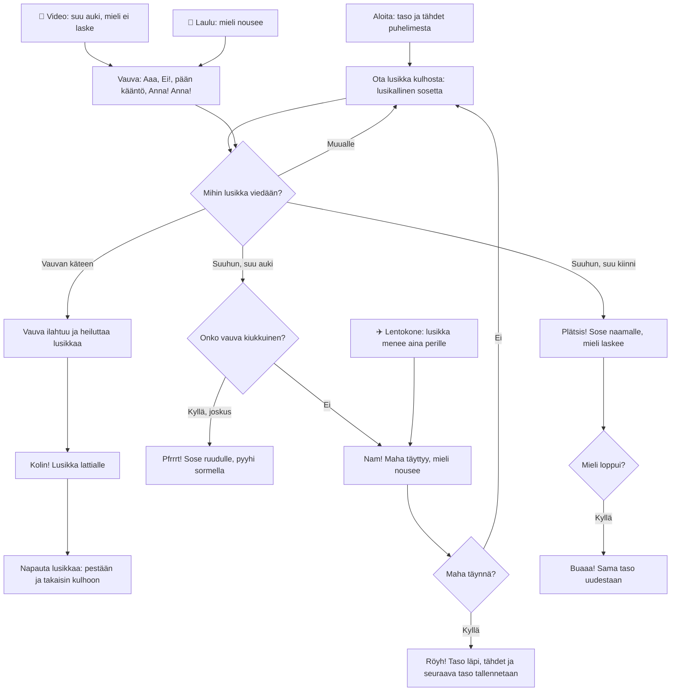

# Vauvan syöttäminen: one level, spoon by spoon

How one level of Vauvan syöttäminen plays (v1). The player carries spoonfuls from the bowl to the
baby's mouth, while the baby opens its mouth, turns away, sways and asks for the spoon. A spoon
given to the baby is dropped on the floor and must be washed. The level is won when the tummy is
full and lost when the baby's mood runs out.

## Colours

- **blue**: what the player does with the spoon
- **amber**: a check that decides the path
- **teal**: giving the spoon to the baby, who drops it
- **violet**: the baby's own moods and the three power-ups
- **green**: a bite eaten, and a level won
- **rose**: a miss, a spit, or a crying baby

## Boxes

- **Aloita: taso ja tähdet puhelimesta**: `games/vauvan-syotto/v1/index.html` reads `ai-pelit:vauvan-syotto:taso` and `:tahdet`; each level wants `6 + 2 × taso` spoonfuls (at most 30).
- **Ota lusikka kulhosta: lusikallinen sosetta**: `down()` lifts the spoon from the bowl already full; dipping an empty spoon back in the bowl fills it (`move()`).
- **Mihin lusikka viedään?**: `up()` checks where the spoon's bowl end is when the finger lifts: at the mouth, at either hand, or elsewhere (back to the bowl).
- **Onko vauva kiukkuinen?**: with mood under 35, no video and no aeroplane, a bite is spat out 45 % of the time (`bite()`).
- **Pfrrrt! Sose ruudulle, pyyhi sormella**: four food splats cover the screen; a finger rubbing them (`wipe()`) clears them, and they fade by themselves in about 14 s.
- **Vauva ilahtuu ja heiluttaa lusikkaa**: `give()`: +25 mood when the baby was reaching for it ("Anna! Anna!"), else +10; the baby bangs it for 1.6-2.8 s in the hand it was given to.
- **Kolin! Lusikka lattialle**: the spoon falls to the floor beside the chair, and there is no feeding until it is washed.
- **Vauva: Aaa, Ei!, pään kääntö, Anna! Anna!**: `nextAct()`: the mouth opens for a shorter time each level, the head turns away more often, and from level 2 the open mouth sways side to side. Not giving the spoon when asked costs 8 mood.
- **📱 Video: suu auki, mieli ei laske**: 6 s of a cartoon on a phone; the baby stares with its mouth wide open and its head still. A spoon the baby is holding still gets dropped, and a bite is still chewed, before it stares again.
- **✈️ Lentokone: lusikka menee aina perille**: the next spoonful, let go anywhere above the bowl, loops into the mouth by itself; let go right at the mouth, it goes straight in. Either way it is never spat out.
- **Röyh! Taso läpi, tähdet ja seuraava taso tallennetaan**: `win()`: 3 stars with no misses, 2 with up to two, else 1. Every four bites in a row without a miss earn one more power-up (at most 3 of each).
