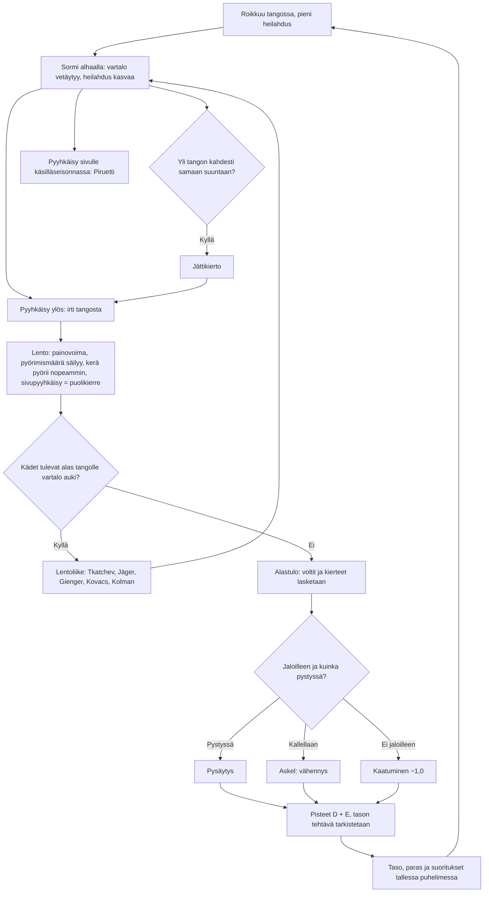

# Voimistelu: one high-bar routine, from the first swing to the score

How one Voimistelu routine plays (v1). The gymnast hangs from the bar, seen from the side with the bar end on. Holding a
finger pulls the body in; done through the bottom of the swing and let go at its ends, it pumps the swing up until the
body goes over the top: a giant swing. A quick flick up lets go of the bar. In the air the body keeps its spin, a held
finger tucks it to spin faster, and a sideways flick adds a half twist. Hands that come down to the bar with the body
open catch it again (a release move); otherwise the routine ends on the mat, where the landing is judged. The score is
the Olympic one: D (the difficulty of each different element) plus E (10 less the deductions).

## Colours

- **blue**: what the player sees and does
- **amber**: a check that decides what happens next
- **teal**: the physics of the flight
- **green**: an element done, or a score kept
- **rose**: a deduction

## Boxes

- **Roikkuu tangossa, pieni heilahdus**: `newRoutine()` in `games/voimistelu/v1/index.html` starts the body 1.2 rad out, still.
- **Sormi alhaalla: vartalo vetäytyy, heilahdus kasvaa**: `barStep()`: a rigid pendulum about the bar whose angular momentum `Lb` only gravity and a little friction change; holding a finger (`hold`) pulls the centre of mass from 1.05 m to 0.85 m and shrinks the body's own inertia, so the swing speeds up as a pumped swing does.
- **Yli tangon kahdesti samaan suuntaan?**: `barStep()` counts each pass over the top; two in a row the same way is a full circle.
- **Jättikierto**: named "taakse" or "eteen" by which side of the body leads (`chest()`), 0,1 each.
- **Pyyhkäisy sivulle käsilläseisonnassa: Piruetti**: `twist()` on the bar, within 0.6 rad of the handstand: a half turn, 0,2; the chest then faces the other way.
- **Pyyhkäisy ylös: irti tangosta**: `onUp()` sees a quick flick up and calls `release()`, which keeps the speed and the spin.
- **Lento: painovoima, pyörimismäärä säilyy, kerä pyörii nopeammin, sivupyyhkäisy = puolikierre**: `airStep()`: a projectile spinning about its centre of mass with constant angular momentum `L`; a tuck has 3.75 times less inertia, so it spins 3.75 times faster.
- **Kädet tulevat alas tangolle vartalo auki?**: `airStep()` catches the bar when the hands come within 25 cm of it, the body is falling, open, and not mid-twist.
- **Lentoliike: Tkatchev, Jäger, Gienger, Kovacs, Kolman**: `grab()` names it by the whole turns in the flight, the half twists and whether the body crossed over the bar, and carries the angular momentum about the bar into the swing.
- **Alastulo: voltit ja kierteet lasketaan**: `land()`: salto 0,1, double 0,3, triple 0,5, and 0,1 a full twist.
- **Jaloilleen ja kuinka pystyssä?**: `land()` looks at the body's lean 0.05 s ahead (`LAND_LOOK`): under 0.3 rad is a stuck landing; up to 1.1 rad a step of 0,1, 0,3 or 0,5; past that, or not feet first, a fall. Still tucked, or mid-twist, costs 0,3 more.
- **Pisteet D + E, tason tehtävä tarkistetaan**: `finish()`: D counts each different element once. Levels 1–10 each ask one element by name (`TASKS`; a harder release move does not stand in for the one asked); from 11 on a score to reach. A fall never passes. `drawResult()` lists each element once with its count, and as many rows as fit, so the scores stay on screen.
- **Taso, paras ja suoritukset tallessa puhelimessa**: `taso`, `paras` and `suoritukset` under `ai-pelit:voimistelu:`.
