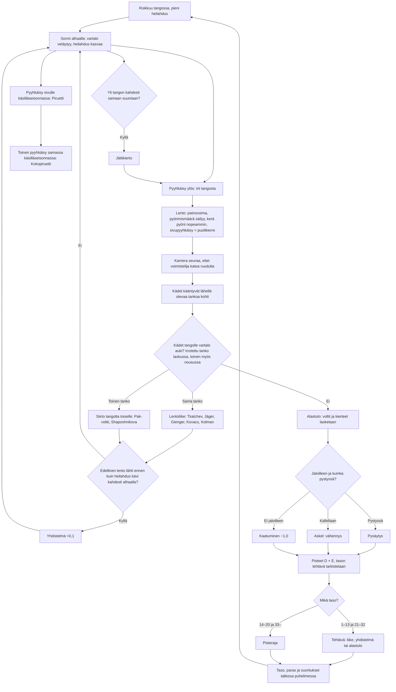

# Voimistelu: one high-bar routine, from the first swing to the score

How one Voimistelu routine plays (v2–v7; v1 is the same with the high bar alone). The gymnast hangs from the high bar, seen from the side with the bar end on. Holding a
finger pulls the body in; done through the bottom of the swing and let go at its ends, it pumps the swing up until the
body goes over the top: a giant swing. A quick flick up lets go of the bar. In the air the body keeps its spin, a held
finger tucks it to spin faster, and a sideways flick adds a half twist. Hands that come down to the bar with the body
open catch it again (a release move; from v4 the arms turn towards a bar within reach first), and v2 adds a low bar in front, as on the women's uneven bars, to fly to and from; otherwise the routine ends on the mat, where the landing is judged. The score is
the Olympic one: D (the difficulty of each different element) plus E (10 less the deductions).

## Colours

- **blue**: what the player sees and does
- **amber**: a check that decides what happens next
- **teal**: the physics of the flight, and the camera
- **green**: an element done, or a score kept
- **rose**: a deduction

## Boxes

- **Roikkuu tangossa, pieni heilahdus**: `newRoutine()` in `games/voimistelu/v2/index.html` (and `v1`) starts the body on the high bar, 1.2 rad out, still.
- **Sormi alhaalla: vartalo vetäytyy, heilahdus kasvaa**: `barStep()`: a rigid pendulum about the bar whose angular momentum `Lb` only gravity and a little friction change; holding a finger (`hold`) pulls the centre of mass from 1.05 m to 0.85 m and shrinks the body's own inertia, so the swing speeds up as a pumped swing does.
- **Yli tangon kahdesti samaan suuntaan?**: `barStep()` counts each pass over the top; two in a row the same way is a full circle.
- **Jättikierto**: named "taakse" or "eteen" by which side of the body leads (`chest()`), 0,1 each.
- **Pyyhkäisy sivulle käsilläseisonnassa: Piruetti**: `twist()` on the bar, within 0.6 rad of the handstand: a half turn, 0,2; the chest then faces the other way.
- **Pyyhkäisy ylös: irti tangosta**: `onUp()` sees a quick flick up and calls `release()`, which keeps the speed and the spin.
- **Lento: painovoima, pyörimismäärä säilyy, kerä pyörii nopeammin, sivupyyhkäisy = puolikierre**: `airStep()`: a projectile spinning about its centre of mass with constant angular momentum `L`; a tuck has 3.75 times less inertia, so it spins 3.75 times faster.
- **Kädet tangolle vartalo auki? Irrotettu tanko laskussa, toinen myös nousussa**: `airStep()` catches a bar when the hands come within 25 cm of it with the body open and not mid-twist. The bar let go of only on the way down; in v2 the other bar (`BARS`: high at 0, low 1.75 m out and 0.9 m lower) also on the way up.
- **Siirto tangolta toiselle: Pak-voltti, Shaposhnikova**: v2 `grab(to)` names it by whole turns (`DOWN`, `UP`): down to the low bar "Siirto alatangolle" 0,1, a Pak salto 0,4 with one turn, "Kaksoisvoltti alatangolle" 0,6 with two or more; up to the high bar a Shaposhnikova 0,4, "Voltti ylätangolle" 0,5, "Kaksoisvoltti ylätangolle" 0,7. On the low bar the legs pike through the bottom so the feet clear the floor (`pk`); only the drawing, so the swing does not pump itself.
- **Kädet kääntyvät lähellä olevaa tankoa kohti**: v4 `aim()` in `games/voimistelu/v4/index.html` (v5 the same, in `v5/`, with arms that turn almost at once: `ARM_RATE` 60 rad/s, a half turn in about 0.05 s, against v4's 14): with the body open, the arms turn at the shoulders, the short way and any way round, towards the nearest bar that may be caught and is within the arm (0.58 m) and 35 cm more of the shoulder, bending at the elbows when it is nearer than the arm (`arm`, `armK`). After such a catch the body eases into line with the arms in about a tenth of a second while the hands stay on the bar (`snap`). In v5 the body instead hangs on a real joint at the shoulders for a moment (`jointStep()`, `jt`): the arms are a rod from the bar, the body two masses on a rod (keeping its centre of mass and own inertia), and the shoulder is loose until gravity and the flight's own spin swing the body within 0.35 rad of the arms' line, then a damped spring holds it there; it turns the arms back as much as the body, so it adds no energy, and while the arms ease to their length the energy is held to what it was at the catch, and from the lock on to what it was at the lock. A held finger pulls the body in through the arms, as on the rigid swing. Then the rigid swing takes over with the same angular momentum, so a catch legs first swings into the hang instead of jumping. Letting go meanwhile keeps the joint's spin.
- **Kamera seuraa, ettei voimistelija katoa ruudulta**: every frame of the flight, v2 `draw()` eases towards the body, then holds every point of it (`bodyPoints()`) at least 15 cm inside all four edges of the screen, however fast, far or high it flies.
- **Lentoliike: Tkatchev, Jäger, Gienger, Kovacs, Kolman**: `grab()` names it by the whole turns in the flight, the half twists and whether the body crossed over the bar, and carries the angular momentum about the bar into the swing.
- **Alastulo: voltit ja kierteet lasketaan**: `land()`: the saltos are the turns the body made between letting go and touching down (`turns()`, half a turn or more counts up, the same rule `grab()` uses); salto 0,1, double 0,3, triple 0,5, and 0,1 a full twist.
- **Jaloilleen ja kuinka pystyssä?**: `land()` looks at the body's lean 0.05 s ahead (`LAND_LOOK`): under 0.3 rad is a stuck landing; up to 1.1 rad a step of 0,1, 0,3 or 0,5; past that, or not feet first, a fall. Still tucked, or mid-twist, costs 0,3 more.
- **Pisteet D + E, tason tehtävä tarkistetaan**: `finish()`: D counts each different element once. Levels 1–10 each ask one element by name (`TASKS`; a harder release move does not stand in for the one asked); v2 adds levels 11–13 for the low bar (any way down to it, then only a Shaposhnikova, then only a Pak salto); after the tasks, a score to reach. Both versions share the saved level. A fall never passes. `drawResult()` lists each element once with its count, and as many rows as fit, so the scores stay on screen.
- **Toinen pyyhkäisy samassa käsilläseisonnassa: Kokopiruetti**: v7 `twist()` in `games/voimistelu/v7/index.html`: a second sideways flick the same way, still within 0.6 rad of the handstand on the same pass (`pir`, cleared by `barStep()` when the body leaves it), makes the pair one "Kokopiruetti" 0,4 instead of two Piruetti; it may come while the first half turn still turns.
- **Edellinen lento lähti ennen kuin heilahdus kävi kahdesti alhaalla?**: asked only once this flight is caught (it hangs off the catch boxes). v7 `release()` noted the last catch (`link`, set by `grab()`, its bottom passes counted by `barStep()`): let go after at most one pass of the bottom, when this flight is then caught too, the two count as connected.
- **Yhdistelmä +0,1**: on the catch of the second flight, never on letting go or on a landing, v7 `grab()` adds the element "Yhdistelmä: <first> + <second>" worth 0,1; D counts each different pair once, as with every element.
- **Mikä taso?**: v7 `TASKS` holds levels 1–13 as before, then `TASKS2` levels 21–32; levels 14–20 keep their score targets, so the saved level means the same in v6 and v7.
- **Tehtävä: liike, yhdistelmä tai alastulo**: `TASKS2`: one task each: giant swings both ways, two different release moves, Kokopiruetti, a connection, a double salto with a twist, down to the low bar and back up, a Kolman, a stuck double salto, three different flights, two connections, D at least 2,5, a stuck triple salto.
- **Pisteraja**: `target(n)`: 10.8 + 0.3 per level from 14 (12.6 at 20); from 33 on it carries on from 12.9 by 0.2 a level, up to 15.5.
- **Taso, paras ja suoritukset tallessa puhelimessa**: `taso`, `paras` and `suoritukset` under `ai-pelit:voimistelu:`.
