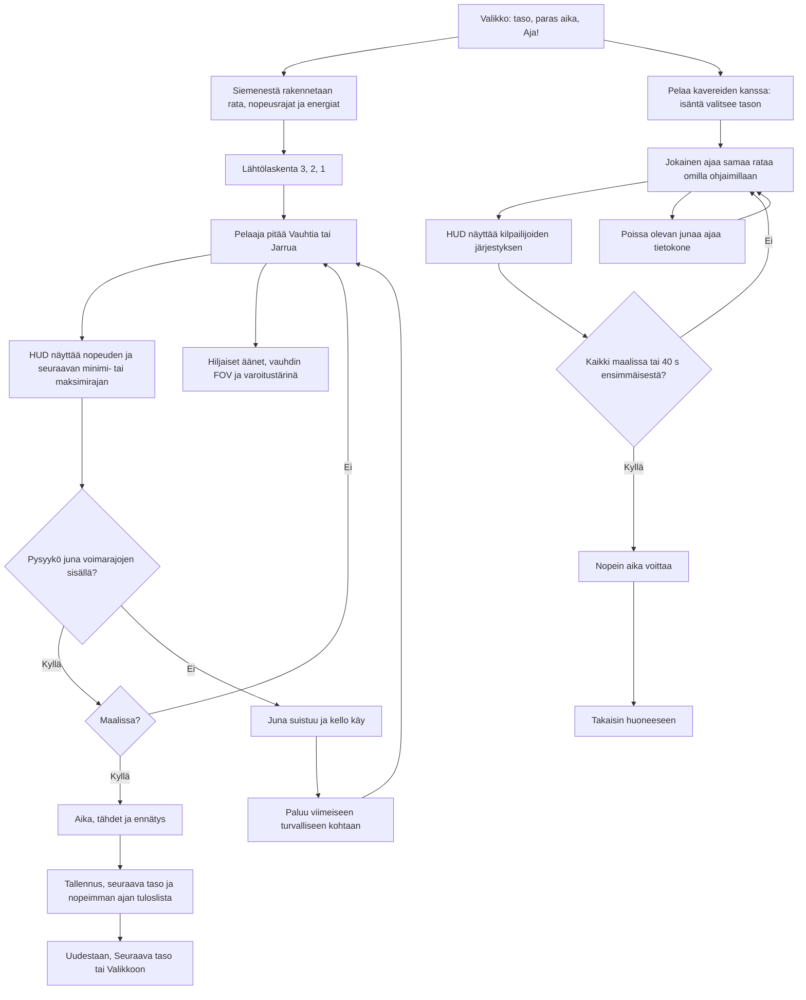

# Vuoristorata: speed-limit driving

Vuoristorata v6 restores the manual speed-management game from versions 1–4. The player holds
Vauhti or Jarru, reads minimum and maximum speed signs, and tries to finish quickly without
derailing. Version 5 remains history with its automatic hands-up scoring and saved point results.

## Colours

- **blue**: what the player sees, hears and does
- **amber**: checks that decide safety, finishing or room progress
- **teal**: how the generated track and recovery work
- **rose**: a derailment that costs time but does not end the round
- **green**: results, saved progress and records
- **violet**: the race with friends

## Boxes

- **Valikko: taso, paras aika, Aja!**: planned `games/vuoristorata/v6/index.html` and `menuText()` in `ride.js` show the selected unlocked level, its fastest saved time and stars. Existing `taso`, `valittu`, `ajat` and `tahdet` saves remain compatible.
- **Siemenestä rakennetaan rata, nopeusrajat ja energiat**: `levelPlan()`, `buildTrack()`, `zones()` and `makeLevel()` restore the v4 course calculation, signs, boost-energy pickups and computer benchmark while retaining the same seeded tracks.
- **Pelaaja pitää Vauhtia tai Jarrua**: two large hold controls feed `readInput()` and `rideStep()`. Pointer-up, pointer-cancel and lost capture always release their control; simultaneous touches remain supported.
- **HUD näyttää nopeuden ja seuraavan minimi- tai maksimirajan**: `hud()` shows km/h, the next sign and its distance. The speed turns red when it is wrong near the warned section.
- **Pysyykö juna voimarajojen sisällä?**: `rideStep()` compares the track's speed-dependent vertical and sideways forces with `LIFT_OFF` and `SIDE_MAX`, allowing the existing grace time before derailment.
- **Juna suistuu ja kello käy**: `crash()` identifies too much speed at a crest or curve, or too little speed in a loop. The crash animation and quiet collision feedback return, and the race clock continues during recovery.
- **Paluu viimeiseen turvalliseen kohtaan**: `rideStep()` records `car.check` outside danger zones and `respawn()` returns there after 1.6 seconds with rolling speed and at least half boost energy.
- **Aika, tähdet ja ennätys**: `finishRide()` compares elapsed time with the computer benchmark, awards one to three stars, and shows the fastest saved time. Finishing unlocks the next level.
- **Tallennus, seuraava taso ja nopeimman ajan tuloslista**: v6 records `ajat`, reuses `tahdet`, and submits seconds to low-is-better `taso-N` boards. Version 5 `pisteet` and `elamys-N` results remain stored as history and are never reinterpreted as times.
- **Hiljaiset äänet, vauhdin FOV ja varoitustärinä**: the current quiet `aanet-5` integration keeps rolling, chain, drop, brake, pickup, collision, start and finish feedback. Speed still controls camera field of view; warning shake returns near a force limit.
- **Pelaa kavereiden kanssa: isäntä valitsee tason**: `public/rooms.js` remains the room entry and the host still chooses the level.
- **Jokainen ajaa samaa rataa omilla ohjaimillaan**: `netStart()`, `netTick()` and room snapshots restore v4-style position, speed and finish-time synchronization while each connected phone drives locally.
- **HUD näyttää kilpailijoiden järjestyksen**: unfinished racers are ordered by distance and finished racers by time, using the compact room HUD.
- **Poissa olevan junaa ajaa tietokone**: while connected, each phone owns and advances its own crash clock; the host records it for takeover but does not echo it back into live play. After continue-without, `botStep()` safely drives that member from the accepted position. The room snapshot carries an active derailment and its remaining 1.6-second penalty, applied once on reload or hand-back, so recovery cannot be skipped or restarted; returning still creates no second result.
- **Nopein aika voittaa**: room results sort by finish time; unfinished racers show no time. The round ends when everyone finishes or 40 seconds after the first finish.
