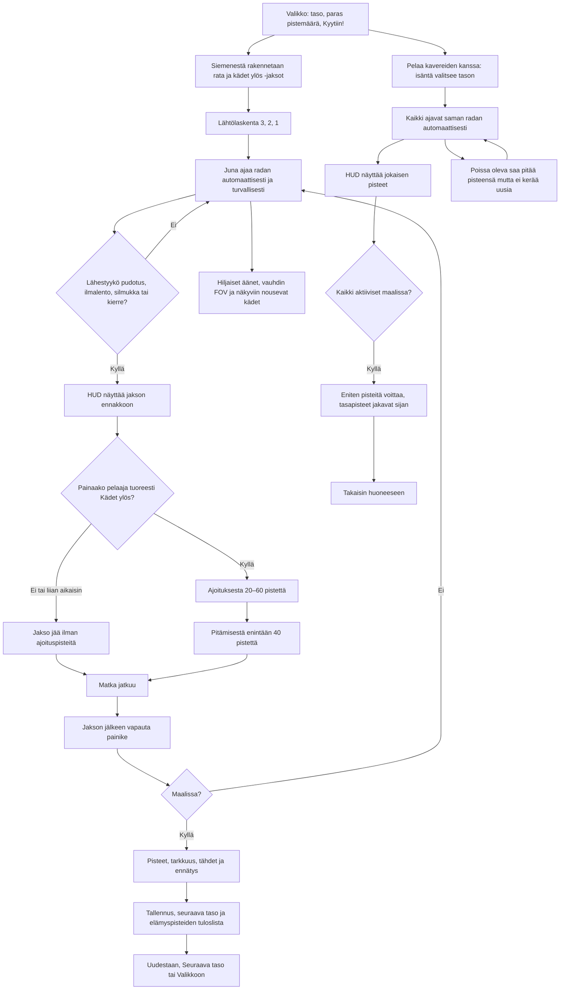

# Vuoristorata: automatic ride with hands-up scoring

Vuoristorata v5 (#459) replaces manual speed management with an uninterrupted automatic ride.
The player presses and holds one Kädet ylös button through drops, airtime hills, loops and
spirals, then releases between them so the next lift can score. Timing and hold length decide the
points, but every ride reaches the station.

Versions 1–4 used Vauhti and Jarru controls, speed signs, derailments and fastest-time scores.
They remain history in `game.json`; v5 uses the flow below.

## Colours

- **blue**: what the player sees, hears and does
- **amber**: a check that decides scoring or progress
- **teal**: how the track and automatic ride work
- **rose**: a missed scoring opportunity, never a failed ride
- **green**: continuation, results and saved progress
- **violet**: the shared ride with friends

## Boxes

- **Valikko: taso, paras pistemäärä, Kyytiin!**: `games/vuoristorata/v5/index.html` and `menuText()` in `ride.js` show the selected unlocked level, its best points and stars, and explain the single hold action. Existing `taso` and `valittu` saves remain compatible; new bests use `pisteet`.
- **Siemenestä rakennetaan rata ja kädet ylös -jaksot**: `levelPlan()` and `buildTrack()` keep the seeded courses. `buildThrills()` merges close `drop`, `hill`, `loop` and `helix` pieces into scoring sections, starts their prompt 24 metres ahead, and gives each a 100-point maximum.
- **Juna ajaa radan automaattisesti ja turvallisesti**: `autoStep()` runs the existing forward-looking computer driver with a wider safety margin and corrects a force-limit edge in place. The player no longer controls speed, and numerical browser tests require levels 1–20 to finish without a crash or respawn.
- **HUD näyttää jakson ennakkoon**: `hud()` names the next exciting piece from its cue point until its end. The one large lower-edge button stays under either thumb in portrait and landscape.
- **Painaako pelaaja tuoreesti Kädet ylös?**: `pressHands()` accepts one fresh pointer-down after the cue. A press held from the countdown or a previous section cannot claim another section until `releaseHands()` sees pointer-up, cancellation or lost capture.
- **Ajoituksesta 20–60 pistettä**: `pressHands()` converts distance from the section start into time at the current speed. An error up to 0.6 seconds earns 60 down to 20 points; an earlier press can still earn hold points but no timing points.
- **Pitämisestä enintään 40 pistettä**: `scoreThrills()` measures fixed simulation time spent hands-up inside the section and awards the same proportion of 40 points. The section is finalized once the train passes its end.
- **Jakson jälkeen vapauta painike**: the car's `ready` flag requires a release between sections. Holding through the whole ride therefore claims at most one section and cannot produce a strong score.
- **Pisteet, tarkkuus, tähdet ja ennätys**: `finishRide()` shows points and percentage of `track.maxScore`; finishing gives one star, 65% two and 90% three. No input, an early full-ride hold, a well-timed hold and generated-level completion have browser tests.
- **Tallennus, seuraava taso ja elämyspisteiden tuloslista**: v5 preserves `ajat`, saves best points under `ai-pelit:vuoristorata:pisteet`, reuses `tahdet` and unlocks the next level on every finish. `public/scores.js` and `server/api.js` order v5 `elamys-N` boards by high points while historical v1–v4 `taso-N` boards retain low times.
- **Hiljaiset äänet, vauhdin FOV ja näkyviin nousevat kädet**: v5 keeps fitting quiet `aanet-5` sounds and the speed-dependent camera field of view. Large hand symbols rise immediately with the hold; obsolete brake, crash, warning and pickup feedback is gone.
- **Pelaa kavereiden kanssa: isäntä valitsee tason**: `public/rooms.js` remains the room entry and the host still chooses the level.
- **Kaikki ajavat saman radan automaattisesti**: `netStart()` and `netTick()` keep the existing host clock and car snapshots while every phone's `autoStep()` drives the same seeded course.
- **HUD näyttää jokaisen pisteet**: packed room snapshots add each player's score, and the compact HUD orders members by points instead of race position. Reload restores at least the host's accepted score before play continues.
- **Poissa oleva saa pitää pisteensä mutta ei kerää uusia**: after continue-without, the computer finishes that member's automatic ride but adds no hands-up points; their earlier score remains.
- **Eniten pisteitä voittaa, tasapisteet jakavat sijan**: `standings()` sorts by score, and `netEnd()` computes displayed ranks from the number of strictly higher scores so equal totals share a place.
