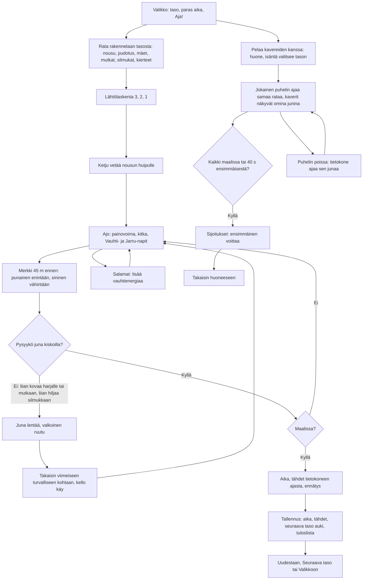

# Vuoristorata: one ride, alone or racing friends

How a ride of Vuoristorata plays (v1, #180). The player sits in the front seat of a roller coaster
drawn in 3D with the shared three.js, holds ⚡ Vauhti to speed up and ✋ Jarru to slow down, and
rides a level's track (a lift hill, drops, hills, banked curves, loops and spirals) to the finish
as fast as they can. Too fast over a crest or into a curve, or too slow into a loop, and the car
flies off; signs before each such place give the speed. With friends, every phone rides the
host's level at once and the first to the finish wins.

## Colours

- **blue**: what the player sees and does
- **amber**: a check that decides the path
- **teal**: how the track is made and what is on it
- **rose**: flying off the track
- **green**: the result and what is saved
- **violet**: racing friends in a room

## Boxes

- **Valikko: taso, paras aika, Aja!**: `games/vuoristorata/v1/index.html` (`#menu`) with `menuText()` in `ride.js`: the level picker (up to the highest unlocked, `ai-pelit:vuoristorata:taso`; the picked one is `valittu`), the level's stars and best time (`tahdet`, `ajat`). Behind it the car rides the track slowly (`step()` in menu mode).
- **Rata rakennetaan tasosta: nousu, pudotus, mäet, mutkat, silmukat, kierteet**: `levelPlan(level)` picks pieces from a seeded random list (the same track on every phone): hills and curves on level 1, loops from 2, sharp airtime hills from 3, spirals from 4, S-bends from 5, longer and tighter up to level 10. `buildTrack()` turns them into samples every 0.5 m (position, the banked frame, and for each the felt vertical and sideways g as `a + b·v²`), and from those each sample's allowed speed range.
- **Merkki 45 m ennen: punainen enintään, sininen vähintään**: `zones()` gathers the places where a limit bites and gives each sign the speed at its start that keeps the whole place safe, rolling; `buildWorld()` in `index.html` puts the sign beside the track, and the HUD shows the next one with its distance, the speed turning red when it is wrong for it.
- **Ajo: painovoima, kitka, Vauhti- ja Jarru-napit**: `rideStep()`: gravity along the slope, rolling friction and air; the held ⚡ Vauhti adds 6.5 m/s² while its energy lasts (the yellow ring), ✋ Jarru takes 9 m/s². Energy comes back slowly, quickly when the car is nearly stopped. The camera sits in the front seat along the track's frame (`place()` in `index.html`) and shakes near a limit.
- **Pysyykö juna kiskoilla?**: `rideStep()`: vertical g under −0.4 (lifted off over a crest, or falling at the top of a loop) or sideways g over 1.35 for more than 0.25 s derails the car.
- **Takaisin viimeiseen turvalliseen kohtaan, kello käy**: `crash()` and `respawn()`: after 1.6 s the car is back at the last place outside a sign's zone (`car.check`), rolling at 25 km/h, with at least half its energy; the clock never stopped.
- **Salamat: lisää vauhtienergiaa**: `makeLevel()` puts a yellow bolt every 90–150 m on calm stretches; riding through one adds 40 % energy.
- **Aika, tähdet tietokoneen ajasta, ennätys**: `makeLevel()` lets `botStep()` (which looks 60 m ahead and keeps inside every limit) ride the level once; within 8 % of its time is three stars, 30 % two, any finish one (`starsFor()`).
- **Tallennus: aika, tähdet, seuraava taso auki, tuloslista**: `finishRide()` saves the best time and stars per level, unlocks the next level, and sends the time to the level's high-score list (`taso-N`, see `tuloslistat.md`).
- **Pelaa kavereiden kanssa: huone, isäntä valitsee tason**: `public/rooms.js` (`data-max="6"`); `roomControls()` shows the host's level picker in the room.
- **Jokainen puhelin ajaa samaa rataa, kaverit näkyvät omina junina**: `netStart()`, `netTick()`: each phone rides its own car and sends where it is ten times a second; the host sends the race (count-down, clock, every car) to all. Friends' trains are drawn in their colours (`trainFor()`), and the HUD lists the places. A phone reloaded mid-race gets the race from the host (`guestState()`) and carries on from where its train was, on the race clock.
- **Puhelin poissa: tietokone ajaa sen junaa**: on "Jatka ilman heitä" (`on('continue')`) the host's `botStep()` rides the away phone's car; it gets it back when it returns (`on('back')`). A finish the computer rode keeps its place but saves no time.
- **Kaikki maalissa tai 40 s ensimmäisestä?**: `netTick()` on the host ends the race and `deliver()`s the standings, ordered by when the host saw each car finish.
