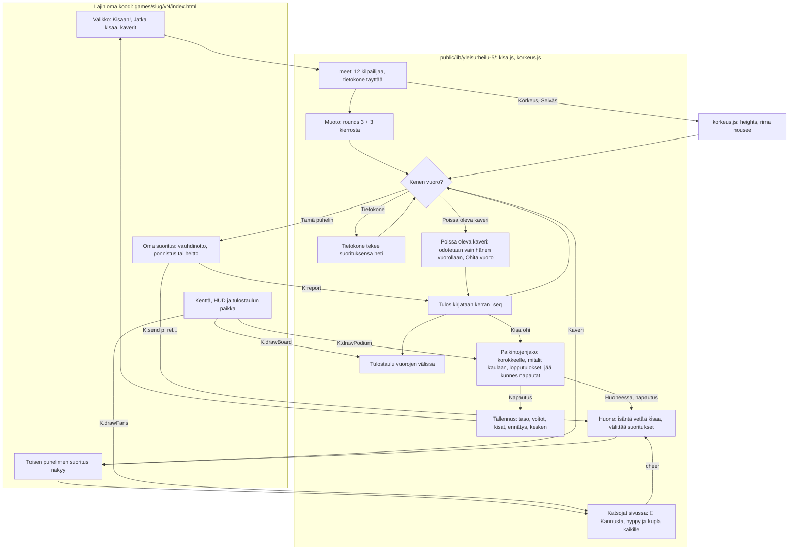

# Yleisurheilukirjasto: the meet shared by the field events

How a field event's version uses the shared athletics library (#165): the game does the attempt
itself (the run-up, the throw or the jump, the drawing), the library runs everything around it:
the field of twelve, whose turn it is, the standings and the results board, the saves, the end of
the meet, and playing it with friends through `rooms.js`. First users: Pituushyppy v2, Keihäänheitto v4, Moukarinheitto v2, Korkeushyppy v2, Seiväshyppy v2. The folder is
frozen once published, like three.js: a change goes in the next folder. `yleisurheilu-2/` (#176,
first user Pituushyppy v5) adds the medal ceremony at the end of the meet. `yleisurheilu-3/` (#176,
first user Pituushyppy v6) keeps the podium until the player taps it away, and has `korkeus.js`
beside `kisa.js` too, so every event can move to it. `yleisurheilu-4/` (#176, first users Korkeushyppy v3
and Seiväshyppy v3) gives medals by place, so a shared place shares the medal. `yleisurheilu-5/` (#297,
first users Pituushyppy v8, Keihäänheitto v7, Kuulantyöntö v2, Moukarinheitto v5, Korkeushyppy v5,
Seiväshyppy v5 and Mäkihyppy v3) waits with friends only for the phone on turn, lets a friend leave and
come back, and shows the friends not on turn as cheering spectators; the next change goes in
`yleisurheilu-6/`.

## Colours

- **blue**: the event's own screens and controls
- **violet**: playing with friends
- **amber**: a check that decides the path
- **teal**: the meet's rules
- **green**: the results and what they save

## Boxes

- **meet: 12 kilpailijaa, tietokone täyttää**: `AiPelitKisa.meet(opts)` in `public/lib/yleisurheilu-5/kisa.js` (#297: the seven events' newest versions; `yleisurheilu-4/` for Kuulantyöntö v1 (#268), Korkeushyppy v3–v4, Seiväshyppy v3–v4 and Mäkihyppy v1–v2; `yleisurheilu-3/` for Pituushyppy v6, Keihäänheitto v5 and Moukarinheitto v3, the same in the rounds format, where places never tie; `yleisurheilu-1/` for the versions made before #176, the same but without the ceremony; `yleisurheilu-2/` for Pituushyppy v5, whose podium goes away by itself), loaded with a classic `<script>` after `rooms.js`. The game gives its slug (save keys), the computer's names (`foes`), its skill by level (`skill`, `spread`, `jitter`), how a computer turn goes (`cpu`), and hooks for a new turn (`turn`), a cleared turn (`clear`), the menu (`menu`) and its live messages (`live`, `watch`). The meet is `K.comp`, plain numbers, the same shape as the v1 games' (so a meet left unfinished in v1 goes on in v2). Mäkihyppy v1 (#269, not an athletics event) uses the meet from `yleisurheilu-4/` with a format of its own (`totals()` in its `index.html`): two rounds, the best ten to the second, standings by the sum of both jumps' points, each mark `{d, p}`. Mäkihyppy v2 (#283) makes the same meet a week of four hills, eight rounds, so the library's podium comes only at the week's end.
- **Muoto: rounds 3 + 3 kierrosta**: `AiPelitKisa.rounds()` in `kisa.js`: the throws and the long jump. Rounds 1–3 in a drawn order, then the best eight three more, the last first; the standings by the best mark, then the second best.
- **korkeus.js: heights, rima nousee**: the bar-height format for the high jump and the pole vault, `AiPelitKisa.heights()`, loaded after `kisa.js` from the same folder. It is in `yleisurheilu-1/` (Korkeushyppy v2, Seiväshyppy v2) and, unchanged, in `yleisurheilu-3/` and `yleisurheilu-4/` for the versions with the ceremony, and in `yleisurheilu-5/` with `missed: 'X'` added; `yleisurheilu-2/` has none. The bar rises through the game's `heights(level)`, three attempts per height in the drawn order, passes, three failures in a row out, the last one in who leads may stop, the countback, and its own board (the attempts at this height; at the end the failures that settle a tie). The computer's start height and passes come from the game's `plan(t, comp)`.
- **Kenen vuoro?**: `advance()` and `follow()` in the library: the computer's turns up to the next player on a phone, then `opts.turn(t, mine, seq)` once per turn, where the game sets up its own attempt (`th`).
- **Tietokone tekee suorituksensa heti**: `opts.cpu(t, comp)`. Before `yleisurheilu-5/` also for a phone that is away after the host's "Jatka ilman heitä" (`R.on('continue')`), until it is back (`R.on('back')`).
- **Poissa oleva kaveri: odotetaan vain hänen vuorollaan, Ohita vuoro**: from `yleisurheilu-5/` (#297) `meet()` calls `R.turns()` with the phone whose turn it is, so the room waits for no one else; a friend who closes the game or leaves the room keeps their competitor, and the computer never takes them. On their turn every phone waits, and the host's "Ohita vuoro" (`R.on('skip')`) records the format's `missed` mark (a foul -1 in `rounds()`, a failed attempt `X` in `korkeus.js`, `{d: 0, p: 0}` in Mäkihyppy v3's `totals()`) through `take(seq, mark, true)`. Back through "↩ Palaa kierrokseen" on the room screen, the host's `hello` sends them the meet as it is.
- **Katsojat sivussa: 📣 Kannusta, hyppy ja kupla kaikille**: from `yleisurheilu-5/`: `K.fans()` is every friend in the meet but the one on turn (faded while their phone is away), drawn by the game with `K.drawFans(ctx, {left, right, bottom, h})` in its scene (each event: a row by the track at the bottom of the scene, in their kit from `opts.look`). On a spectator's phone the library shows a "📣 Kannusta" button (`cheerButton()`, from `K.step()`; bottom right, or `opts.cheerAt`); a tap sends `cheer`, the host passes it to every phone, and that figure jumps with its arms up under a bubble ("Hyvä Aino!", the name of the one on turn) while the crowd sound plays (`yleiso` from the game's `aanet`, or `opts.cheerSound`). Bubbles of cheers at once stack upwards.
- **Tulos kirjataan kerran, seq**: `K.report(seq, mark)`: alone or on the host it is recorded at once (`take()`), a guest sends `res`; the host takes it only from the phone whose turn it is and only for the turn now (`seq`), saves an unfinished meet alone (`kesken`) and sends the meet to every phone (`c`).
- **Tulostaulu vuorojen välissä**: `K.drawBoard(ctx, false, box)` draws the standings between turns into the box the game gives (`true` still draws v1's plain final board).
- **Palkintojenjako: korokkeelle, mitalit kaulaan, lopputulokset**: `K.drawPodium(ctx, box)` and `podium()` in `kisa.js` (#176): the top three hop onto the podium (bronze, silver, gold), an official walks over the blocks and hangs each medal around the neck, they cheer under confetti, and the final standings show under the podium (beside it on a phone on its side). The game may give `opts.look(row)` (an outfit palette) and `opts.chime(i)` (a sound per medal). From `yleisurheilu-3/` it stays until the player leaves it: `K.skip()` (the game calls it on a tap) finishes the ceremony alone (`PODIUM_DONE`), and a tap after the ceremony sets `leave`, so `K.step(dt)` goes to the menu or the room (`R.backToRoom()`, the top eight with `R.note()`); with friends each phone leaves by its own tap. `yleisurheilu-2/` went on by itself after 11 s. From `yleisurheilu-4/` the medals go by place (`medalOf()`), not by order: a full countback tie in the bar-height format shares the place, so both get the same medal in the standings and on the podium, where everyone placed 1st–3rd stands on their place's block (a shared place side by side, smaller, however many), the official hangs their medals one after another, and the next medal is skipped.
- **Tallennus: taso, voitot, kisat, ennätys, kesken**: `ai-pelit:<slug>:…`, the keys the v1 games already use. A win alone adds a win and a level; the best mark goes to the high-score list (`AiPelitScores.submit()`); `K.record(mark)` saves a record the moment it is set.
- **Huone: isäntä vetää kisaa, välittää suoritukset**: the library's `R.on('start' | 'message' | 'hello' | 'continue' | 'back' | 'lobby' | 'leave' | 'menu')`. The game's live messages (`opts.live`, e.g. Pituushyppy's `p`, `rel`, `leg`) go through `K.send()`; the host adds whose turn it is and passes them to every phone's `opts.watch`. Message types `c`, `res`, `end`, `fit` (an outfit, when the game gives `opts.fit`) and `cheer` (from `yleisurheilu-5/`) are the library's. A returning or reloaded phone gets the meet from the host (`hello`).
- **Oma suoritus: vauhdinotto, ponnistus tai heitto**: the game's own code, unchanged from its previous version.
