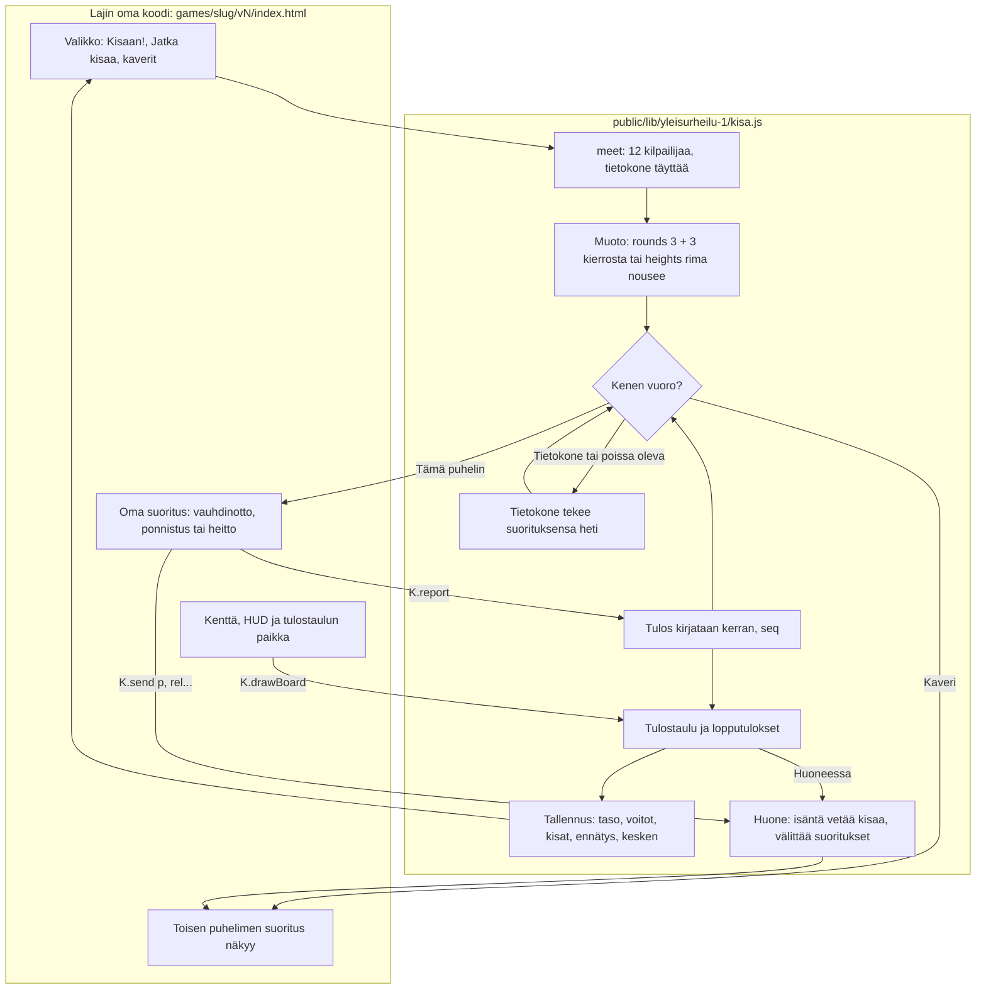

# Yleisurheilukirjasto: the meet shared by the field events

How a field event's version uses the shared athletics library (#165): the game does the attempt
itself (the run-up, the throw or the jump, the drawing), the library runs everything around it:
the field of twelve, whose turn it is, the standings and the results board, the saves, the end of
the meet, and playing it with friends through `rooms.js`. First users: Pituushyppy v2, Keihäänheitto v4, Moukarinheitto v2, Korkeushyppy v2. The folder is
frozen once published, like three.js: a change goes in `yleisurheilu-2/`.

## Colours

- **blue**: the event's own screens and controls
- **violet**: playing with friends
- **amber**: a check that decides the path
- **teal**: the meet's rules
- **green**: the results and what they save

## Boxes

- **meet: 12 kilpailijaa, tietokone täyttää**: `AiPelitKisa.meet(opts)` in `public/lib/yleisurheilu-1/kisa.js`, loaded with a classic `<script>` after `rooms.js`. The game gives its slug (save keys), the computer's names (`foes`), its skill by level (`skill`, `spread`, `jitter`), how a computer turn goes (`cpu`), and hooks for a new turn (`turn`), a cleared turn (`clear`), the menu (`menu`) and its live messages (`live`, `watch`). The meet is `K.comp`, plain numbers, the same shape as the v1 games' (so a meet left unfinished in v1 goes on in v2).
- **Muoto: rounds 3 + 3 kierrosta tai heights rima nousee**: `AiPelitKisa.rounds()`: the throws and the long jump. Rounds 1–3 in a drawn order, then the best eight three more, the last first; the standings by the best mark, then the second best. The bar-height format for the high jump and the pole vault is `AiPelitKisa.heights()` in `korkeus.js` beside it (Korkeushyppy v2): the bar rises through the game's `heights(level)`, three attempts per height in the drawn order, passes, three failures in a row out, the last one in who leads may stop, the countback, and its own board (the attempts at this height; at the end the failures that settle a tie). The computer's start height and passes come from the game's `plan(t, comp)`.
- **Kenen vuoro?**: `advance()` and `follow()` in the library: the computer's turns up to the next player on a phone, then `opts.turn(t, mine, seq)` once per turn, where the game sets up its own attempt (`th`).
- **Tietokone tekee suorituksensa heti**: `opts.cpu(t, comp)`; also for a phone that is away after the host's "Jatka ilman heitä" (`R.on('continue')`), until it is back (`R.on('back')`).
- **Tulos kirjataan kerran, seq**: `K.report(seq, mark)`: alone or on the host it is recorded at once (`take()`), a guest sends `res`; the host takes it only from the phone whose turn it is and only for the turn now (`seq`), saves an unfinished meet alone (`kesken`) and sends the meet to every phone (`c`).
- **Tulostaulu ja lopputulokset**: `K.drawBoard(ctx, final, box)` draws the standings between turns and the medals at the end into the box the game gives; `K.step(dt)` shows the results for a few seconds, then the menu or the room (`R.backToRoom()`, the top eight with `R.note()`).
- **Tallennus: taso, voitot, kisat, ennätys, kesken**: `ai-pelit:<slug>:…`, the keys the v1 games already use. A win alone adds a win and a level; the best mark goes to the high-score list (`AiPelitScores.submit()`); `K.record(mark)` saves a record the moment it is set.
- **Huone: isäntä vetää kisaa, välittää suoritukset**: the library's `R.on('start' | 'message' | 'hello' | 'continue' | 'back' | 'lobby' | 'leave' | 'menu')`. The game's live messages (`opts.live`, e.g. Pituushyppy's `p`, `rel`, `leg`) go through `K.send()`; the host adds whose turn it is and passes them to every phone's `opts.watch`. Message types `c`, `res`, `end` and `fit` (an outfit, when the game gives `opts.fit`) are the library's. A returning or reloaded phone gets the meet from the host (`hello`).
- **Oma suoritus: vauhdinotto, ponnistus tai heitto**: the game's own code, unchanged from its previous version.
