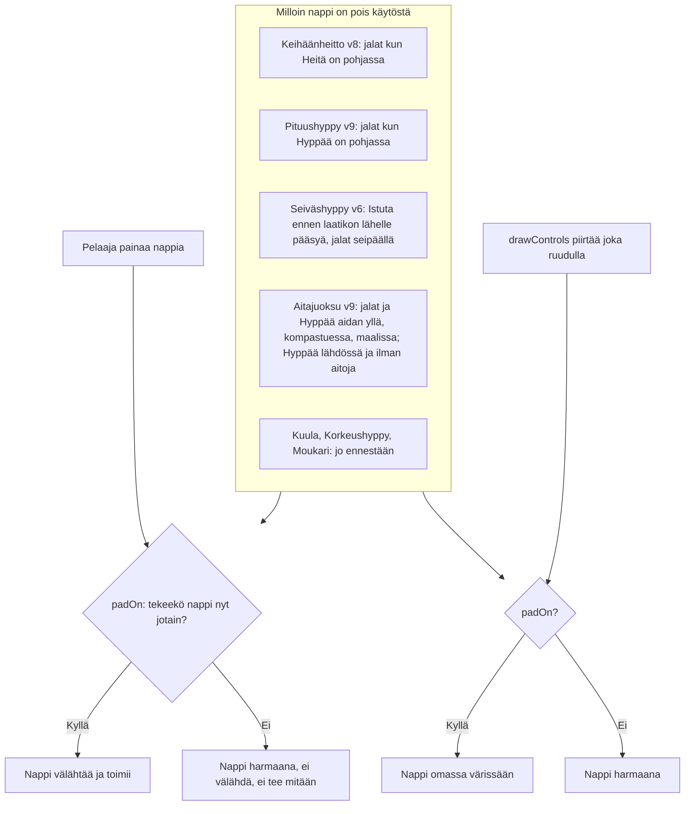

# Yleisurheilun napit: a pad that does nothing is greyed out

When each pad of an athletics event is on (#313). Every event decides, for each pad and each
moment, whether pressing it would do something (`padOn()`). An "on" pad is drawn in its colour
and lights up when pressed; an "off" pad is greyed out and does not light up, so the player does
not think it works. Shot put, high jump and hammer already worked this way; this Work brings
hurdles, long jump, javelin and pole vault in line.

Since #346 only each game's newest version folder is kept: a `games/<slug>/v<N>/` path below that is not the newest names a version that is history now (its files are in git's history, and the site sends its address to the newest), and what it says about that version is how it was.

From #404 each press and letting go here counts at its own moment, not at the last drawn frame: see `reilu-ajoitus.md`.

## Colours

- **blue**: what starts it: a press or a frame drawn
- **amber**: the one question, `padOn()`, asked by both
- **green**: the pad is on
- **rose**: the pad is off, greyed out
- **teal**: the events changed in this Work, and when their pads are off
- **violet**: events that already greyed out their idle pads

## Boxes

- **Pelaaja painaa nappia**: `press()`, `startAim()` (javelin, long jump) or `hold()` (pole vault) in each event's `index.html`; they set the pad's flash only when `padOn(k)` is true, then do what they did before.
- **padOn: tekeekö nappi nyt jotain?**: `padOn(k)` beside `drawControls()`, written to match exactly when the press functions act: the same phase and position checks.
- **drawControls piirtää joka ruudulla**: draws an off pad in `#22385a` with `#6f86a6` text, the colour every event already used for a pad between turns.
- **Keihäänheitto v8: jalat kun Heitä on pohjassa**: `games/keihas/v8/index.html`. While aiming, `press()` returns before adding speed; v7 still flashed the feet (#312).
- **Pituushyppy v9: jalat kun Hyppää on pohjassa**: `games/pituushyppy/v9/index.html`. In the air every pad is the legs, once, so they stay on until the legs are thrown.
- **Seiväshyppy v6: Istuta ennen laatikon lähelle pääsyä, jalat seipäällä**: `games/seivashyppy/v6/index.html`. `hold()` ignores a press before `PLANT_FROM`, so the plant pad wakes there, as Korkeushyppy v5's take-off does at `JUMP_FROM`.
- **Aitajuoksu v9: jalat ja Hyppää aidan yllä, kompastuessa, maalissa; Hyppää lähdössä ja ilman aitoja**: `games/aitajuoksu/v9/index.html`. At the start the feet stay on: a step there is a false start, which is something. With no hurdles the jump pad was already grey but still hopped; now it does nothing. A runner with a red card (out of the race, with friends) has every pad off, the jump too.
- **Kuula, Korkeushyppy, Moukari: jo ennestään**: Kuulantyöntö v2, Korkeushyppy v5 and Moukarinheitto v5 already drew each pad from whether it acts (`on` in their `drawControls()`), and lit only those; no new version.
