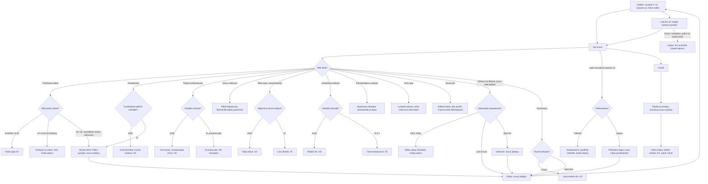

# Yöajo: poliisi, tankkaus, Lappi ja loputon yö

The plan for Yöajo's next versions (#440): what the police do, how fuel works, the new things on
the road, the exits and junctions where the route turns, the three new Lapland legs to Utsjoki, the endless night and the whole-trip summary.
One leg's own rules (lights, overtaking, moose, cameras, coffee) are in `yoajo.md`; this diagram
shows only what is added around them. v12 is built (police and the police check); v13–v16 are the approved plan, and their boxes are rewritten to the code as each is built. Paths name the version that adds each.

## Colours

- **blue**: what the player sees and does
- **amber**: a check that decides the path
- **teal**: points for driving well
- **rose**: a penalty, or the end of the leg
- **green**: arriving, records and the trip's totals

## Boxes

- **Valikko: osuudet 1–11, Loputon yö, Koko matka**: `menu()` in `ui.js` lists eleven legs (`LEGS` in `game.js`, three new after Rovaniemi in v15), a "🌌 Loputon yö" button (open once leg 1 is driven, `ajettu >= 1`) and a "🏁 Koko matka" button for the summary.
- **Poliisiauto näkee**: v12 `policeLeg()` and `policeSees()` in `games/yoajo/v12/poliisi.js`. Marked police cars (white, blue and yellow checks, a light bar, `policeMesh()` in `view.js`) from leg 2: 0, 1, 1, 2, 2, 2, 3, 3 on legs 1–8 (`POLICE_CARS`), in turn parked at a side road's mouth with a radar, oncoming, or driving ahead. A moving one sees the player within 250 m in front of it or 120 m behind (`SEE_AHEAD`, `SEE_BEHIND`), a parked one 200 m up the road and 60 m past (`RADAR`, `RADAR_PAST`), in a blizzard only as far as the beam reaches; `clearView()` hides the player over a crest or round a sharp bend. "🚓 Poliisi näkee" shows under the speedometer while one does.
- **Mitä poliisi näkee?**: v12 `police()` (Eero's choice after the challenge): 10 km/h over or less, nothing; more than 10 and under 20 over for a second, `fine()`; 20 or more over for half a second, `caught()`. `policeSaw()` from `unsafeOvertake()` (an unsafe overtake, or crossing a junction's solid line) and `policeDazzled()` from `lights()` (the dazzle `fine()`s when that police car sees the player, `policeSees()`; assumed). Out of their sight these keep their old minus points; cameras keep their fine.
- **Pysäytys ja sakko -150, matka jatkuu**: v12 `fine()` and `policeHold()`: a police car with blue lights (`partio`) comes up behind, the screen's left and right edges flash blue in turn (`dashboard()` in `ui.js`), "Siniset vilkut: pysähdy tien sivuun" and a short quiet siren (`sirenSound()` in `ui.js`); the car brakes itself to a stop on the shoulder, waits 3 s, then "Poliisi: ylinopeus 14 km/h, sakko -150" (or "häikäisit poliisiautoa") and the drive goes on. Counted in `tally.sakot` and `tally.poliisi`.
- **Siniset vilkut: Poliisi pysäytti, osuus päättyy**: v12 `caught()`: the police car's lights flash, a patrol pulls in behind, the siren plays and the leg ends on the crash screen (title "Poliisi pysäytti!") with the reason ("Poliisi pysäytti: 124 km/h, rajoitus 100.", "Poliisi pysäytti: vaarallinen ohitus.", "Poliisi pysäytti: ohitit sulkuviivan yli.") and a hint. In the endless night (v16) the run ends.
- **Pysähdyitkö poliisin kohdalle?**: v12: under 5 km/h for 1.5 s (`BLOW_STILL`) from 10 m before the officer to 3 m past, in the right half of the road (their side), then "Puhalla…" for 2 s with the brake held, then "0,00 ‰ – hyvää matkaa! +20" (`tally.puhallus`). More than 6 m past them without having blown ends the leg: "Poliisi pysäytti: ajoit puhalluskokeen ohi." Driving into the officer is a crash.
- **Puhalluskoe**: v12 `placeCheck()` and `policeCheck()`: from leg 3 (`CHECK_FROM`), one check a leg, 200 m into a pothole stretch (`CHECK_IN`), so under its 50 limit, clear of cameras, junctions, other signs and moose; a POLIISI sign 50 m into the stretch, cones along the edge (`checkCones()` in `view.js`), the police car with its lights on a widened shoulder (`road.pads`) and an officer with a vest and a red baton (`officerMesh()`). From 300 m: "Puhalluskoe N m: pysähdy poliisin kohdalle".
- **Tietyö ja liikennevalo**: v13: a 300 m roadworks stretch with one lane open, cones and a temporary light (60 s cycle shortened to 12 s); oncoming cars come through on their green.
- **Sumu notkossa**: v13: on dry and rain legs, fog lies in the dips; inside it high beams reach only 30 m, low beams 45 m, and the screen whitens with high beams on.
- **Rikki auto, varoituskolmio**: v13: a car with hazard lights half on the shoulder, a red triangle 50 m before it, someone beside it with a reflector.
- **Ambulanssi takana**: v13: blue lights in the mirror (a strip at the top), siren; move right over the edge line and ease off so it passes.
- **Erikoiskuljetus vastaan**: v13: an escort car with yellow lights, then a wide house half in the player's lane; move onto the shoulder and below 50, otherwise a crash.
- **Aura-auto**: v13: on snow legs, a slow snowplough with orange lights throws a snow cloud behind it; the road ahead of it is clean, behind it slushy.
- **Musta jää**: v13: from leg 5, shiny patches on bridges and in dips, shown by a sign "Liukas ajorata"; grip halves on them.
- **Käännyitkö opastetusta?**: v14 `risteys.js`: 1–3 turns a leg along the real route, an exit ramp off the motorway (legs 1–2) or a crossroads where Valtatie 4 turns (from leg 3). Blue direction signs at 600 m and 150 m and an arrow on the screen show the way; the straight-on road is a real side road.
- **Vilkku syttyy itsestään, matka jatkuu**: v14 `autoBlink()` (Eero's choice: no signal buttons): the blinker lights from the steering as the car turns. A left turn in front of an oncoming car within 4 s is −50 and reckless.
- **Väärä tie: osuus päättyy**: v14 `wrongWay()` (Eero's choice): 250 m down the wrong road ends the leg on the crash screen, "Väärä tie: ajoit ohi käännöksen."; in the endless night it ends the run.
- **Tasoristeys**: v14 (leg 4 and Lapland): a level crossing with lights and barriers; a train passes in 6 s.
- **Polttoainetta?**: v15 `fuel()` in `tie.js` (Eero's choice: only on the Lapland legs and in the endless night): a gauge beside the speedometer; a Lapland leg starts with enough to reach its station at the limits; use grows with the speed squared. In the endless night fuel carries over between stages.
- **Huoltoasema: pysähdy mittarille, tankki täyttyy**: v15: a service station with pumps and coffee on each Lapland leg, and every other stage in the endless night; stopping at a pump fills 10 % a second. The rest areas on legs 1–8 stay as they are.
- **Koko matka: tähdet, pisteet, km, sakot, hirvet**: v15 `tripScreen()` in `ui.js`: the best points and stars per leg summed, plus lifetime counters saved as `ai-pelit:yoajo:tilasto` (km driven, legs driven, police stops, fines, moose and reindeer avoided). Shown from the menu, and after Rovaniemi and Utsjoki.
- **Loputon yö: etappi toisensa perään**: v16 `endless()` in a new `loputon.js`: stages of about 3 km made from a running seed, each a little harder (more traffic, worse weather, more moose, police). Between stages the screen fades for a second and the car keeps its speed, fuel and alertness.
- **Loppui: km ja pisteet listalle loputon**: v16: the run's points (with +20 a km driven) go to the high-score list `loputon`; the best is saved as `loputon`.
