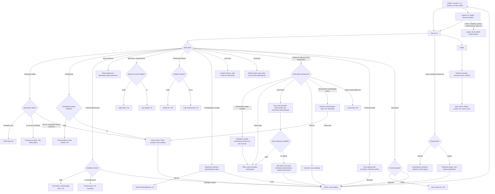

# Yöajo: poliisi, tankkaus, Lappi ja loputon yö

The plan for Yöajo's next versions (#440): what the police do, how fuel works, the new things on
the road, the exits and junctions where the route turns, the three new Lapland legs to Utsjoki, the endless night and the whole-trip summary.
One leg's own rules (lights, overtaking, moose, cameras, coffee) are in `yoajo.md`; this diagram
shows only what is added around them. v12 (police and the police check), v13 (road events), v14 (turns and the level crossing) and v15 (Lapland, fuel and the trip's totals) and v16 (the endless night) are built; v19 (#451) makes the crossroads turns forgiving. Paths name the version that adds each.

## Colours

- **blue**: what the player sees and does
- **amber**: a check that decides the path
- **teal**: points for driving well
- **rose**: a penalty, or the end of the leg
- **green**: arriving, records and the trip's totals

## Boxes

- **Valikko: osuudet 1–11, Loputon yö, Koko matka**: v15 `menu()` in `games/yoajo/v15/ui.js` lists eleven legs (`LEGS` in `game.js`: Rovaniemi → Sodankylä, Sodankylä → Ivalo, Ivalo → Utsjoki after leg 8), opened one by one as before (`maxLeg`, `taso`, up to 11). A phone that had driven leg 8 in v14 (`ajettu` 8, `taso` stopped at 8) gets leg 9 open when the game loads. When a row would be under 30 px (34 upright), the list shows a window of legs with "▲ aiemmat" and "▼ myöhemmät" buttons (`menuTop`), keeping the chosen leg in view. "🏁 Koko matka" sits beside "Ohjaus". v16 adds "🌌 Loputon yö" beside "Aja" (`endlessOpen()` in `games/yoajo/v16/loputon.js`: open once leg 1 is driven, `ajettu >= 1`; locked before, with "Aja ensin osa 1"; it shows the best run). v17 (`games/yoajo/v17/ui.js`): the menu subtitle shows the selected leg's two- and three-star score targets from `STAR_POINTS`; all other controls stay in place. The regular-leg score rule is drawn in `yoajo.md`.
- **Poliisiauto näkee**: v12 `policeLeg()` and `policeSees()` in `games/yoajo/v12/poliisi.js`. Marked police cars (white, blue and yellow checks, a light bar, `policeMesh()` in `view.js`) from leg 2: 0, 1, 1, 2, 2, 2, 3, 3 on legs 1–8 (`POLICE_CARS`), in turn parked at a side road's mouth with a radar, oncoming, or driving ahead. A moving one sees the player within 250 m in front of it or 120 m behind (`SEE_AHEAD`, `SEE_BEHIND`), a parked one 200 m up the road and 60 m past (`RADAR`, `RADAR_PAST`), in a blizzard only as far as the beam reaches; `clearView()` hides the player over a crest or round a sharp bend. "🚓 Poliisi näkee" shows under the speedometer while one does.
- **Mitä poliisi näkee?**: v12 `police()` (Eero's choice after the challenge): 10 km/h over or less, nothing; more than 10 and under 20 over for a second, `fine()`; 20 or more over for half a second, `caught()`. `policeSaw()` from `unsafeOvertake()` (an unsafe overtake, or crossing a junction's solid line) and `policeDazzled()` from `lights()` (the dazzle `fine()`s when that police car sees the player, `policeSees()`; assumed). Out of their sight these keep their old minus points; cameras keep their fine.
- **Pysäytys ja sakko -150, matka jatkuu**: v12 `fine()` and `policeHold()`: a police car with blue lights (`partio`) comes up behind, the screen's left and right edges flash blue in turn (`dashboard()` in `ui.js`), "Siniset vilkut: pysähdy tien sivuun" and a short quiet siren (`sirenSound()` in `ui.js`); the car brakes itself to a stop on the shoulder, waits 3 s, then "Poliisi: ylinopeus 14 km/h, sakko -150" (or "häikäisit poliisiautoa") and the drive goes on. Counted in `tally.sakot` and `tally.poliisi`.
- **Siniset vilkut: Poliisi pysäytti, osuus päättyy**: v12 `caught()`: the police car's lights flash, a patrol pulls in behind, the siren plays and the leg ends on the crash screen (title "Poliisi pysäytti!") with the reason ("Poliisi pysäytti: 124 km/h, rajoitus 100.", "Poliisi pysäytti: vaarallinen ohitus.", "Poliisi pysäytti: ohitit sulkuviivan yli.") and a hint. In the endless night (v16) the run ends.
- **Pysähdyitkö poliisin kohdalle?**: v12: under 5 km/h for 1.5 s (`BLOW_STILL`) from 10 m before the officer to 3 m past, in the right half of the road (their side), then "Puhalla…" for 2 s with the brake held, then "0,00 ‰ – hyvää matkaa! +20" (`tally.puhallus`). More than 6 m past them without having blown ends the leg: "Poliisi pysäytti: ajoit puhalluskokeen ohi." Driving into the officer is a crash.
- **Puhalluskoe**: v12 `placeCheck()` and `policeCheck()`: from leg 3 (`CHECK_FROM`), one check a leg, 200 m into a pothole stretch (`CHECK_IN`), with the normal road limit from v17 (the owner removed potholes’ automatic 50 limit), clear of cameras, junctions, other signs and moose; a POLIISI sign 50 m into the stretch, cones along the edge (`checkCones()` in `view.js`), the police car with its lights on a widened shoulder (`road.pads`) and an officer with a vest and a red baton (`officerMesh()`). From 300 m: "Puhalluskoe N m: pysähdy poliisin kohdalle".
- **Tietyö ja liikennevalo**: v13 `roadLeg()` and `roadTick()` in `games/yoajo/v13/tie.js` (leg 2, `ROAD_EVENTS`; leg 1 keeps none of the new events): an 80 m stretch (`WORK_LEN`) with the right lane shut by cones, a temporary light at the stop line and a second line 40 m past the far end (`FAR_STOP`) where oncoming cars wait. A 26 s cycle (`WORK_CYCLE`): the player's green 6 s, then the oncoming cars' turn for 2.5 s once the stretch is empty (`worksOpen()`). Limit 50 from 120 m before, a TIETYÖ sign at 200 m, "Tietyö: yksi kaista, odota vihreää". Cars on both sides queue behind each other at their line (`roadMove()`). Clear of junctions, rest areas and police checks.
- **Odotitko vihreää?**: v13 `roadTick()`: past the stop line on red, −50 "Punaisia päin" (`tally.punaiset`, counted as reckless); stopped before the line on red and through on green, +20 "Odotit vihreää" (`tally.tietyo`). Into the cones of the shut lane: "Ajoit tietyömaalle.", the leg ends.
- **Sumu notkossa**: v13 `fogAt()` and `fogReach()` (legs 2–4): up to two of the leg's deepest dips, at least 600 m apart, 140 m of fog (`FOG_HALF`) thinning over its last 25 m. In it high beams reach only 30 m and low beams 45 m (`FOG_HIGH`, `FOG_LOW`), high beams whiten the screen (0.4) and earn no long-beam points, and the 3D fog closes in. "Sumua: lähivaloilla näkee paremmin".
- **Rikki auto, varoituskolmio**: v13 (legs 2, 3, 6): a car with its hazard lights blinking half on the shoulder (`BROKEN_LAT`), a red triangle 50 m before it (`triangleMesh()` in `view.js`) and a walker with a reflector beside it. Traffic in the player's lane rounds it only with the other lane free, otherwise waits behind it.
- **Hiljensit ja kiersit väljästi?**: v13: judged as the player goes by: under 0.8 m from it faster than 40 km/h, −40 "Liian läheltä rikkinäistä autoa" (`tally.lahelta`); a metre or more, +20 "Väljä ohitus".
- **Ambulanssi takana**: v13 `ambulance()` (legs 3, 4, 5, 8): it comes up from behind with blue lights and a siren (a blue strip flashes at the top of the screen, "Ambulanssi takana: väistä oikealle"), waits 18 m behind until the player moves right of 2.6 (`YIELD_LAT`), then passes. Other cars move right for it too, oncoming ones to their own edge.
- **Väistitkö oikealle?**: v13: moved right before 5 s behind (`BLOCK_TIME`): +30 "Päästit ambulanssin ohi" (`tally.ambulanssi`) when it has passed. After 5 s: −50 "Tukit ambulanssin" (`tally.tukit`, which also takes the third star), and it passes in the oncoming lane once that is clear.
- **Väistit erikoiskuljetusta +20**: v13 `roadTick()`: 50 km/h or less as the load goes by, +20 (`tally.erikois`).
- **Erikoiskuljetus vastaan**: v13 (legs 4, 7): two escort cars with orange beacons and between them a 16 m house 4.6 m wide (`loadMesh()`), half over the centre line, at 40 km/h; cars behind it follow at its speed. From 400 m "Erikoiskuljetus vastaan: oikeaan reunaan ja alle 50". Over 50 km/h as it goes by: "Vaaratilanne: ohitit erikoiskuljetuksen liian kovaa." and the leg ends; otherwise +20 (`tally.erikois`).
- **Aura-auto**: v13 (legs 5–8): a snowplough at 40 km/h with orange beacons ahead in the player's lane; within 50 m behind it (`CLOUD_BACK`) its snow cloud whitens the screen, thickest close up. Overtaking it is worth 60.
- **Musta jää**: v13 `iceAt()` and `gripAt()` (legs 5–8): up to two 50 m shiny patches, each after a "Liukas ajorata" sign 150 m before it; grip halves on them. "Musta jää: ei jarrua eikä äkkiohjausta".
- **Risteys tai liittymä, jossa käännytään**: v14 `turnLeg()` in `games/yoajo/v14/risteys.js`, right after `makeRoad()`: 1, 1, 1, 1, 2, 2, 3, 3 turns on legs 1–8 (`TURNS`), an exit ramp to the right off the motorway on legs 1–2 (0.6 rad on 70 m) and a crossroads where Valtatie 4 turns a quarter round on 28 m from leg 3. v18 (#440 owner correction) replaces the early left ramp with an 8 m corner and 2 m easing, so the right-hand lane crosses the opposing lane only within the cross-road mouth and joins the right-hand lane of the left-going road. The incoming road remains straight up to this compact junction; `LEFT_SPEED` is 18 km/h for traffic and braking advice says 20 km/h. Right turns and motorway ramps retain their geometry. Each bends the road itself, with 140 m straight before and 100 m after on level ground; the road straight on is drawn as a side road of its own (`frameTurn()`), and no trees grow inside the corner (`inCorner()` in `view.js`). Each leg is 400 m longer per turn (`LEGS` in `game.js`) and nothing else is placed within 250 m before a turn or 120 m after it, so everything v13 had still fits. Blue direction signs 600 m and 150 m before, on the turn's side (`suunta`); the far one steps out of a road event's stretch (`turnSigns()`) or a police check (`placeCheck()` in `poliisi.js`). From 600 m "Käänny oikealle/vasemmalle … m", and an arrow pill on the screen (`turnHint()`). Traffic cars slow for the turn too (`turnCruise()`).
- **Risteyksen sisällä vastakkaisen kaistan yli, alle 30 km/h**: v18 `turnLeg()` in `games/yoajo/v18/risteys.js` uses an 8 m left corner with 2 m easing; the player stays on the incoming right-hand lane until crossing the opposing lane within the cross-road mouth and leaves on the outgoing right-hand lane. `turnCruise()` slows traffic to 18 km/h. v19 (#451): the player's advice is 30 km/h (`turnSafe()` in `games/yoajo/v19/risteys.js`), shown on the turn pill the whole way in.
- **Auto valuu kaarteen ulkoreunalle, sitä enemmän mitä kovempaa**: v19 (#451) `drive()` in `games/yoajo/v19/game.js` with `turnPush()` in `risteys.js`: inside a crossroads turn's bend the outward push is `steerMax(v) × (v / safe)²` (`steerMax` = full steering's sideways speed), where `safe` is the turn's safe speed (left 30 km/h, right 50 km/h, times `min(1, grip + 0.25)` as in `turnCruise()`), with no 1.8× slide step. Because the bend is short, a player who steers in within 0.4 s drifts about 1.5 m wide at the safe speed and still makes a dry left turn at 35 km/h and a right one at 60 (`tests/test_yoajo_v19_risteys.py` drives every crossroads turn of legs 3–8 at its safe speed half a second late, and a dry left one at 35 and 50). Ramps and ordinary bends keep the v18 rule.
- **Vielä risteyksen asfaltilla?**: v19 `onJunction()` in `games/yoajo/v19/risteys.js`, used by `drive()` in `game.js`: within a crossroads turn (30 m before its start to 30 m after its end) the car is in the ditch only once it is more than `DITCH` (5.6 m) from the bend's line and also more than `DITCH` from every drawn road of the junction (`armDist()`). The junction's paving does not slow the car as gravel does, and the car can go at most 12 m wide there.
- **Ajoit ojaan: liian lujaa vasempaan käännökseen, hidasta alle 30 km/h**: v19 `ditchWhy()` (in a turn's bend, or up to 34 m past a crossroads bend, where the paving let the car run wide) and the crash screen in `ui.js`: the message and tip name the kind of turn and its weather-adjusted safe speed ("vasempaan käännökseen", "oikeaan käännökseen", "rampille"), rounded to the nearest 5 km/h (a blizzard: 25 left, 40 right). The blue turn pill shows "· alle <N>" (e.g. "Käänny vasemmalle 450 m · alle 30") the whole way from 600 m, not only once.
- **Käännyitkö opastetusta?**: v14 `turnTick()`: decided `TURN_EASE` (8 m) into the turn: the car has turned if it steered towards it within the last 33 m (`P.into`).
- **Vilkku syttyy itsestään, matka jatkuu**: v14 `turnTick()` (Eero's choice: no signal buttons): within 150 m the blinker comes on by itself, to the turn's side, once the car slows under 60 km/h (a crossroads) or 80 (a ramp), steers into it, or reaches it; off once round. Going too fast: off the road in a turn's bend over its safe speed (`turnSafe()`) is "Ajoit ojaan: liian lujaa vasempaan käännökseen." / "… oikeaan käännökseen." / "… rampille." (`ditchWhy()`, v19; v14–v18 said "risteykseen").
- **Väärä tie: osuus päättyy**: v14 `wrongRoad()` (Eero's choice): straight on past a turn, "Väärä tie!" and a red pill; the car drives on down the side road and 250 m on (`WRONG_LEN`) the leg ends, "Väärä tie: ajoit ohi käännöksen.", with a hint on the crash screen.
- **Käännyit vastaantulijan eteen -50, hurjastelu**: v14: at a left turn a car comes from the road ahead (`crosser()`), set off so that it reaches the crossing about when the player does. Turning while it is under 4 s (`GAP_TIME`) from the crossing is −50 and counts as reckless (`tally.hurjastelu`); the car brakes and honks. Once through the crossing it leaves the side road (`t.arm = null`) and is an ordinary oncoming car on the player's road, drawn and hit there. A police car that sees it (`policeSaw()`) ends the leg, "Poliisi pysäytti: vaarallinen käännös.". v18: `crosser()` in `games/yoajo/v18/risteys.js` keeps the straight-through car at its normal speed while the player waits; only `yieldT`, set after an unsafe turn, requests emergency braking. `J.done` remains the branch-choice checkpoint eight metres into the turn, rather than the geometric end of the corner.
- **Annoit tietä +20**: v14: stopped before the turn while that car came, then turned after it: +20 (`tally.kaannos`).
- **Tasoristeys**: v14 `railCrossing()` and `roadTick()` in `tie.js` (leg 4, `ROAD_EVENTS`; v15 also leg 9, Rovaniemi → Sodankylä, in place of the wide load): its 360 m are kept first in `newLeg()` (`road.railAt`). 220 m before (`RAIL_WARN`) "Juna tulee: puomit laskeutuvat", the lights blink and a bell rings, the barriers come down from 1.5 s to 4 s, a train goes by from 6 s and they lift at 15–17 s. Cars queue before it. Driving between the barriers while they are down: "Ajoit puomien läpi tasoristeyksessä.", the leg ends.
- **Juna menee ohi +20**: v14: stopped within 60 m before it while the barriers were down: +20 "Juna meni ohi" (`tally.juna`) once over.
- **Polttoainetta?**: v15 `fuelLeg()` and `lappiTick()` in `games/yoajo/v15/lappi.js` (Eero's choice: only on the Lapland legs, `fuel: true` in `LEGS`, and in the endless night): a "Tankki" gauge under the speedometer (`dashboard()` in `ui.js`). A leg starts with 1.3 times what driving at the limits takes to its service station (`FUEL_MARGIN`); use grows with the speed squared (`burnRate()`), so at 130 km/h the tank runs dry before the station. Under 15 % (`FUEL_LOW`) "Tankki vähissä: huoltoasema N km" once. On legs 1–8 `P.fuel` is null and nothing shows.
- **Huoltoasema: pysähdy mittarille, tankki täyttyy**: v15: on a Lapland leg the rest area is a service station (`station` on its bay in `newLeg()` in `game.js`): blue "huolto" signs at 500 m and 100 m with a pump and "☕ Kahvi", a lit canopy with two pumps (`restStop()` in `view.js`), and "⛽ Huoltoasema N m: oikealle ja pysähdy" on the screen. Stopped on its paving (`P.lat > EDGE + 0.5`, under 1 m/s) the tank fills 10 % a second (`FUEL_FILL`), "Tankataan… N %", then "Tankki täynnä" (`tally.tankkaus`, once a station); the coffee works as at a rest area. The rest areas on legs 1–8 stay as they are. v16: every other stage in the endless night.
- **Polttoaine loppui, auto rullaa pysähdyksiin**: v15 `lappiTick()`: at empty "Polttoaine loppui!", the gas pulls nothing (`P.dry`, `drive()` in `game.js`) and the car slows by 1.5 m/s² more (`FUEL_ROLL`); under 0.5 m/s the leg ends, "Polttoaine loppui.", and the crash screen says "Tankki tyhjä!" with "Tankkaa huoltoasemalla: aja oikealle ja pysähdy pumpulle." (`crashScreen()` in `ui.js`).
- **Porot ylittävät yksi kerrallaan: hidasta ja odota**: v15 `herdLeg()` in `lappi.js` (`herds` in `LEGS`: 1, 2, 2 on legs 9–11): after a reindeer sign, a herd of 3–5 (`HERD_MIN`, `HERD_MAX`) steps out one after another, a few metres apart, each standing on the road 2–4.5 s (`hold`; a lone one 1.6 s, `release()` and `move()` in `game.js`). Hitting one ends the leg ("Törmäsit poroon."). Legs 9 and 11 are clear frosty nights (`pakkanen`) with stars and green northern lights (`aurora()` in `view.js`), leg 10 a blizzard; leg 11 runs over bare fells with hardly a tree (`fells()`). The Lapland legs (`straights: true` in `LEGS`) have long empty straights: `makeRoad()` in `game.js` makes 60 % of the road's pieces straight instead of 40 %, each 2.5 times as long (200–850 m), from the same random numbers, so legs 1–8 keep their road; their traffic was already thin.
- **Koko matka: tähdet, pisteet, km, sakot, hirvet**: v15 `tripScreen()`, `tripTotals()` and `tripLog()` in `lappi.js`: the route with each leg's stars (a lock on legs not open), the stars out of 33 and the best points summed, plus lifetime counters saved as `ai-pelit:yoajo:tilasto` (km driven, legs driven to the end, police stops, fines, moose and reindeer got past, fuel stops), added when a leg ends (driven to the end, crashed, or left from the pause) and when the page is hidden or left (`pagehide`, `visibilitychange`: the "‹ Pelit" chip's way back to the shelf, closing the app), each time only what is new since the last (`tally.logged`), and nothing for a leg left before 30 m. From the menu's "🏁 Koko matka", and from the end screens of leg 8, Rovaniemi (under "Seuraava", which stays first), and leg 11, Utsjoki (`doneScreen()` in `ui.js`); "Takaisin" returns there.
- **Loputon yö: etappi toisensa perään**: v16 `startEndless()`, `endlessStage(k)` and `nextStage()` in `games/yoajo/v16/loputon.js` (loaded after `lappi.js`; `newLeg()` in `game.js` builds a stage in place of a leg while `endless` is set). Each run has a random seed. Stage k runs between two villages of `VILLAGES` (23, stepped by 7), 2600 m plus 400 m a turn (`turns`: 1 + k/3, at most 3), and takes leg k+1's road events (`tpl`, from stage 11 legs 7–11 in turn); traffic, trucks, cameras, moose, reindeer, herds, racers and potholes grow with k, the police with 1 + k/3 cars (at most 4, `leg.police` in `poliisi.js`), the weather follows `ENDLESS_WEATHER` (dry, rain, dry, snow, frost, blizzard, then at random). No town limit and no rest area on odd stages (`noBay`): a service station every other stage. A full tank lasts 12 km at 80 (`ENDLESS_TANK`, `burnRate()` in `lappi.js`), alertness 10 km (`ENDLESS_AWAKE`). At a stage's end (`finish()`) `nextStage()` keeps the car's speed, lane, tank, alertness, lights and points, and a finger or key still held keeps driving (`setThumbs()` in `ui.js`), the screen fades from black over a second (`endlessFade()`, "Etappi N" and the villages) and "Etappi 3 · 9 km" shows. Each whole km pays +20 (`endlessTick()`); the dashboard shows "N. A → B" and "Yht. X km".
- **Loppui: km ja pisteet listalle loputon**: v16 `endlessOver()` from `crash()` in `game.js`: any end of a stage ends the run (a crash, falling asleep, the police, an empty tank, a wrong road). The points go to the high-score list `loputon` (`AiPelitScores.submit`, `board('loputon')`, allowed by `GAMES` in `server/api.js`), and the best run is saved as `ai-pelit:yoajo:loputon` (`{p, km, k}`). `endlessScreen()` replaces the crash screen: the reason, the stage and km reached, the points and the record, "Aja uudelleen" (a new run) and "Valikko" (`leaveEndless()`: back to the leg picked before).
