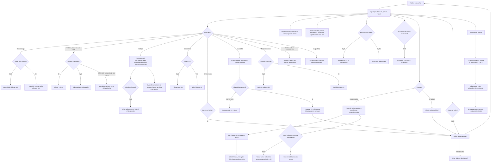

# Yöajo: one leg of the night drive

How one leg of Yöajo plays (v1, #181; v4 drives with one thumb as a round stick and adds the reckless-driving rules; v3 steers and presses the gas with one thumb a side; v2 is the same game, sized from the real screen so it fits at once after going full screen: `index.html` and `fitCheck()` in `games/yoajo/v2/ui.js`; v5 shows the speed on a car's dial at the top, #206; v6 plays recorded sounds from the shared library, #235; v7 shows and explains the potholes, #266; v8 adds junctions with cars pulling out, no overtaking through them, a rest area with a lane of its own, the lights button on the left and a livelier gas pedal, #306). The player drives at night up Valtatie 4 from Helsinki
to Rovaniemi, one leg a level, seen in 3D from behind the car. In v1 and v2 the car pulls up
to speed by itself and the player steers and brakes with buttons; in v3 the left thumb steers and
the right thumb presses the gas or brakes, by how far each slides. The player also switches the
high beams. On the road come oncoming cars,
slow tractors, trucks and cars to overtake, walkers, reckless drivers, bad stretches, speed
cameras, moose (and reindeer in Lapland), rain and snow, and the driver grows sleepy.

Since #346 only each game's newest version folder is kept: a `games/<slug>/v<N>/` path below that is not the newest names a version that is history now (its files are in git's history, and the site sends its address to the newest), and what it says about that version is how it was.

v9 (#337) loads `aanet-4`, which plays the loudest sounds (tyres, the horn, the winning tune) quieter.

v10 (#355) loads `aanet-5`, where the sounds Eero still found too loud are swapped for softer ones he picked by ear, or play quieter (the winning and losing tunes); nothing else changed.

v11 (#377) lets the car drive forward out of the rest area along its lane, and traffic behind drives past a parked car with enough room. The exit follows the narrowing paving fully onto the road; traffic still waits if the parked car overlaps its path.

v12 (#440) adds the police and the police check, drawn in `yoajo-matka.md`: `games/yoajo/v12/poliisi.js` places them in `newLeg()` from their own random numbers (so everything v11 placed stays put), `drive()` calls `policeHold()`, `policeCheck()` and `police()`, `unsafeOvertake()` and `lights()` tell the police what they saw, and `bayWidth()` widens the shoulder for the check's police car (`road.pads`) as for the rest area.

v13 (#440) adds the road events, also drawn in `yoajo-matka.md`: `games/yoajo/v13/tie.js` places them in `newLeg()` after the police (`roadLeg()`, its own random numbers again), `drive()` calls `roadTick()`, `move()` calls `roadMove()` for every car (and `ambulance()` for the ambulance), the grip is multiplied by `gripAt()`, the beams' reach goes through `fogReach()`, and `unsafeOvertake()` does not count the open lane of roadworks as overtaking. `crashScreen()` in `ui.js` grows its panel to fit the reason and the hint above the buttons (v12: a fixed 270 px, where a two-line reason ran under them).

v14 (#440) adds the turns and the level crossing, drawn in `yoajo-matka.md`: `games/yoajo/v14/risteys.js` bends the road at each turn in `newLeg()` right after `makeRoad()` (`turnLeg()`), before anything else is placed; the level crossing's stretch is kept next, then the rest as before, each leg 400 m longer per turn. `drive()` calls `turnTick()`, and on the wrong road `wrongRoad()` instead of the rest; `move()` hands the car from the road ahead to `crosser()`, and the traffic's speed is capped by `turnCruise()`. `draw3d()` in `view.js` looks less far ahead in a turn, so the camera follows the bend.

v15 (#440) drives on into Lapland, drawn in `yoajo-matka.md`: `games/yoajo/v15/lappi.js` (loaded after `risteys.js`) gives `newLeg()` the reindeer herds (`herdLeg()`) and the tank (`fuelLeg()`), `drive()` calls `lappiTick()` (fuel, the pump, animals got past), and a leg's end, crash or leaving it adds to the trip's totals (`tripLog()`). `view.js` draws the frosty nights, the northern lights, the fells and the service station.

v16 (#440) adds the endless night, drawn in `yoajo-matka.md`: `games/yoajo/v16/loputon.js` (loaded after `lappi.js`) makes each stage for `newLeg()` while `endless` is set (`endlessStage()`), `finish()` drives on into the next stage (`nextStage()`) and `crash()` ends the run (`endlessOver()`), whose points go to the list `loputon`.

v17 (#440) awards stars from driving points alone, before the time bonus. Time adds its existing bonus to the leaderboard score only; it cannot change the stars. Previously earned stars and high scores stay saved.

## Colours

- **blue**: what the player sees and does
- **amber**: a check that decides the path
- **teal**: points for driving well
- **rose**: a penalty, or the end of the leg
- **green**: arriving, stars and records

## Boxes

- **Valitse osuus, Aja**: the menu (`menu()` in `games/yoajo/v1/ui.js`) lists the eight legs of `LEGS` in `game.js`, from Helsinki → Järvenpää to Oulu → Rovaniemi; a leg opens when the one before is driven (`maxLeg`, saved as `ai-pelit:yoajo:taso`). Each leg has its own weather (dry, rain, snow, blizzard) and its own mix of traffic. `newLeg()` builds the road (`makeRoad()`: bends and hills from the leg's seed), the speed limits and signs, and the list of what happens where (`events`). v15 (#440): eleven legs, on to Utsjoki; the three in Lapland are drawn in `yoajo-matka.md` (`games/yoajo/v15/lappi.js`).
- **Aja: ohjaa, kaasuta, jarruta, valot**: `drive()` in `game.js`. v1 and v2: the car pulls up to 130 km/h by itself unless JARRU is held, and ◀ ▶ buttons steer fully. v3 (#181 feedback, Eero's choice): one thumb a side, anywhere below the top line (`thumbs` and `setThumbs()` in `games/yoajo/v3/ui.js`). The left thumb slides sideways from where it landed: a short slide is a gentle turn, a long one sharper than v1's buttons (`input.steer`, the slide to the power 1.4). The right thumb is the gas: landing is a light press (35 %), sliding up gives more, up to full, and sliding down past where it landed brakes by how far (`input.gas`, `input.brake`). Off the gas the engine slows the car a little. A bend pushes the car outwards, more the faster and the slipperier (`WEATHER[...].grip`). VALOT (a button in the middle in v3) switches between low beams (42 m) and high beams (135 m), less in rain and snow; `view.js` draws them as one spot light, so what is beyond the beam stays dark. v4 (#181, Eero's choice after trying a prototype): one thumb as a round stick like Areena's, 56 px across its radius, wherever the thumb lands (`oneThumbGuide()`, `STICK` in `games/yoajo/v4/ui.js`): sideways steers, up is gas, down brakes, and diagonals do both. The lights move to the lower right corner. The menu's "Ohjaus" switch picks v3's two thumbs instead (saved as `ohjaus`). v4 also gives traffic a speed habit (`cruise()` in `game.js`): each car keeps to the limit where it is, some 12–22 km/h under (the ones to overtake), most about at it, a few 6–15 over; trucks keep to 80 or up to 4 km/h over. The reckless driver from behind slows behind the player instead of driving into them. Limits change less (one stretch every 1.3–2 km), and 60 (villages, with street lights) comes only from leg 5. v8 (#306): the lights button is in the lower left corner with one thumb (v4–v7: lower right; with two thumbs it stays in the middle), and the idle stick waits right of the middle (`stickHome()` in `games/yoajo/v8/ui.js`). The gas pulls 2.5 times harder (`PULL` in `drive()`): full gas takes the car from 0 to 100 in about 7 s (v1–v7: about 17 s); each gas still settles at the same speed, and easing off slows the car as before. Unsafe overtaking is judged within 130 m of an oncoming car (`ONCOMING_GAP`, v4–v7: 180 m).
- **Nopeusmittari yläreunassa: viisari, rajoitus vieressä**: v5 (#206: "nopeusmittari yläreunaan, samannäköinen kuin auton nopeusmittari"; Eero picked the round dial). `speedometer()` and `speedoBox()` in `games/yoajo/v5/ui.js` draw a round dial in the top middle, under the trip line: 0–200 km/h, ticks every 10, numbers every 20, a red needle (`needleAngle()`: 0 at the lower left, 100 straight up, 200 at the lower right), the speed in digits in the gap at the bottom (red more than 5 over the limit), and the rim red above the limit. The time, distance and alertness sit on its left, the points and the limit sign on its right. No thumb starts on it (`thumbTop()`). Up to v4 the speed was digits by the lights button. Sounds stay as v4's; recorded ones came in v6.
- **Pitkät pois ajoissa?**: `lights()` in `game.js`. An oncoming car is released 620 m ahead; if the high beams were on when it came into sight and are off before it is 150 m away, +20. Still on at 150 m: −30 and it flashes its own at the player. A car ahead within 70 m dazzled for 1.5 s costs −20. v4 (#181: the dazzle came too easily): judged at 90 m, and a car ahead after 2.5 s within 50 m. v12 (#440): dazzling a police car this way also calls `policeDazzled()`, a stop and a −150 fine.
- **Ohitus +40..60**: `meet()`: passing a slow vehicle in the player's direction scores once (tractor 40, car 50, truck 60). Same-direction cars keep behind slower ones and behind the player.
- **Väljä ohitus +20**: walkers keep to the left edge facing traffic, or now and then the right edge; a third have no reflector and show only in the beam. Passing with under a metre of room above 40 km/h costs −40; touching one ends the leg as a near miss ("Vaaratilanne").
- **Jarrutit tai väistit?**: a moose (or a reindeer on the last leg) steps out of the forest about four seconds of driving ahead, after a warning sign; some stop on the road. Its eyes shine in the beam (`deerMesh()` in `view.js`).
- **Kuoppa -15, neljäs kova isku puhkaisee renkaan**: `holes()`: a bad stretch after an "Epätasainen tie" sign has potholes; below 50 km/h (v1–v6; up to 55 km/h from v7) they do nothing, above it they jolt the car; the fourth hit above 70 km/h bursts a tyre.
- **Kuoppamerkki, 50-rajoitus, varoitus ruudulla**: v7 (#266 "Mitä kuopille mahtaa?", Eero's choice: show and explain, same difficulty). `newLeg()` in `games/yoajo/v7/game.js` puts a 50 limit 40 m after each bad stretch's sign, over all its holes, and the limit it was 290 m after the sign (other limit changes inside the stretch go; the stretch is kept in `road.bad`). `holes()` says "Kuoppia: hidasta alle 50 km/h" once per stretch. `buildWorld()` in `view.js` lays each hole on the crowned road with a pale rim the headlights catch (v1–v6 drew them at a flat height, under the asphalt within 1.25 m of the centre line). The menu's tip on a leg with bad stretches is "Kuoppamerkin jälkeen hidasta alle 50 km/h." (`menu()` in `ui.js`).
- **Kuopat eivät tee mitään**: v7: up to 55 km/h (`HOLE_SAFE`, the 50 limit and a little), a hole does nothing; v1–v6 under 50.
- **Ohje: hidasta alle 50 km/h**: v7: the burst-tyre screen (`crashScreen()` in `ui.js`) adds "Kuoppien kohdalla hidasta alle 50 km/h." under the reason.
- **Yli rajoituksen +5?**: `cameras()`: a camera stands 340 m after its sign; over the limit by more than 5 km/h it flashes and fines −150, otherwise +25.
- **Ohittaja omalla kaistalla: väistä pientareelle**: two kinds of reckless drivers (`move()`): one from behind with high beams on, overtaking when nobody comes and cutting in; one oncoming, pulling out from behind a truck into the player's lane with its high beams on.
- **Kahvitauko: vireys täyteen, +10 s**: `tiredness()` (#181 "Kuskia väsyttää"), from leg 3. Sleepiness grows with the road driven; past 40 % the eyes close for a moment now and then (black lids in `dashboard()`), longer as it grows. Stopping in the rest area's bay (a sign, then a paved bay and a lit kiosk on the right) wakes the driver; without a stop they fall asleep after the rest area, before the town.
- **Aikabonus: +10 p sekunnilta alle tavoiteajan**: `finish()` in `games/yoajo/v17/game.js` adds `max(0, round((parTime() - T) * 10))` to the driving points, as before. Stars are already decided from driving points and never use the bonus.
- **Tähdet ajopisteistä: perillä 1, pisterajoista 2 tai 3**: v17 (#440, owner choice): `starsForPoints(level, drivingPoints)` before the time bonus. `STAR_POINTS` gives each leg its two- and three-star score targets, reachable without a time bonus. Fines, dazzling, unsafe passes, reckless driving and blocking an ambulance affect stars only through point deductions. `starTargetText()` in `games/yoajo/v17/ui.js` shows the selected leg's targets below the menu title and on the results screen. `tahdet` keeps the best stars, never taking away an earned star. Old `pisteet` records include the bonus, so they are preserved without guessing their driving points.
- **Seuraava osuus aukeaa, ennätys tuloslistalle**: stars and best points per leg are saved (`tahdet`, `pisteet`), and the furthest leg driven to the end as `ajettu` (`taso`, the furthest leg open, stops at 8; at 11 from v15, and `server/api.js` takes `osa-1` to `osa-11`, and from v16 `loputon`, the endless night's list). The points of every leg driven to the end, even at zero or below after fines, go to the leg's high-score list `osa-N` (`public/scores.js`, `server/api.js`), with `ajettu` shown beside them. `buildWorld()` and `dispose()` in `view.js` free the old leg's 3D pictures and the passed traffic, so driving leg after leg does not fill the phone's memory. This game keeps its own score entry; the shared registry’s new `minigolf` entry (#340, lowest stroke total on `main`) does not change it. Kiekkoammunta v1 adds independent `trap` and `skeet` score entries (Trap first, N/25); this box’s existing behavior is unchanged. Frisbeegolf v1 adds its own `main` entry to these registries: lowest strokes against par wins, displayed as `E`, `−2` or `+5`; this box keeps its existing behavior. Frisbeegolf now uses its separate `v3` leaderboard; versions 1–2 are not accepted there (#338). From v5 (#429) its rounds go to a new `v5` list, the shelf's first, and the `v3` list stays for v3–v4.
- **Vaarallinen ohitus -50, ei ohituspisteitä**: v4 `unsafeOvertake()` in `game.js`, judged before any pass is scored in the same moment: being past the centre line while an oncoming car is within 180 m costs 50, once a car, and every vehicle passed before the car is back in its lane earns nothing (`P.unsafe`). v12 (#440): if a police car sees it (`policeSaw()` in `poliisi.js`), the unsafe overtake, or crossing a junction's solid line, ends the leg instead.
- **+5 joka 100 m, ei katuvaloissa**: v4 `highBeams()`: every 100 m on high beams earns 5 points, announced every 500 m and shown on the end screen as "Pitkillä ajettu". Not under street lights (`streetLit()`: the town at the end and the villages). After 6 s on low beams with an empty road ahead, a reminder.
- **Hurjastelu -25, joka 5 s uudelleen**: v4 `reckless()`: 20 km/h or more over the limit for over a second costs 25, and again every 5 s it goes on.
- **Äänet: moottori ja sade silmukkana, jokaiselle tapahtumalle oma ääni**: v6 (#235) loads `lib/aanet-2/aanet.js` (#205); the sound code is the "Sound" part of `games/yoajo/v6/ui.js`, called from `game.js`. Two loops start with the first tap: `moottori`, its pitch following the speed and its volume the gas, silent off the road (`engineSound()`), and `sade` on rain, snow and blizzard legs (softer and lower on snow) while the leg goes on, paused too, silent on the crash and end screens. Events: `naksu` for the lights and every menu button, `tomahdys` for a pothole (`holes()`, also the fourth hard hit that bursts the tyre, before its screech), `kamera` then `virhe` for a camera fine (`cameras()`), `torvi` when a driver is dazzled (`lights()`), `suhahdus` when a truck is beside the car, oncoming or overtaken (`meet()`), `kitka`, `kolari` and `lasi` for a crash (`crash()`; a walker who jumped aside and a burst tyre only screech), `voitto` at the end of a leg (`finish()`). Each falls back to v5's beep while its file is not loaded; the whoosh, the glass and the fine's buzz have none.
- **Risteysmerkki, ohituskieltomerkki, yhtenäinen keltainen keskiviiva, katuvalo**: v8 (#306 "Välillä voisi olla risteyksiä mistä tulee autoja", "Ohituskielto merkinnät risteyksien kohdalla"). `newLeg()` in `games/yoajo/v8/game.js` places two or three side roads a leg (`road.junctions`, `LEGS[...].junctions`), each from its own random numbers so the rest of the leg stays where v7 had it; they keep clear of the rest area and the bad stretches only. Each has a junction warning sign 140 m before, a no-overtaking sign where the solid centre line starts, and the line from 110 m before to 30 m after (`road.nopass`, `noPass()`). `view.js` paves the side road out to the forest (`sideRoads()`, `paved()`), breaks the edge line at its mouth, draws the centre line solid there (patchy under snow, and in a blizzard, where no other line shows, still the solid line here and there), and hangs a street light over the mouth (`junctionLamp()`).
- **Ohitit sulkuviivan yli -30, ei ohituspisteitä**: v8 `unsafeOvertake()`: the car's centre over the centre line within a no-overtaking stretch costs 30 once until it is back in its lane, counts as reckless (no third star), and the pass earns nothing.
- **Sivutieltä auto eteen tai vastaan: jarruta tai ohita myöhemmin**: v8 `joiner()` in `game.js`: nine side roads in ten have a car waiting, facing the road. It pulls out into the player's lane ahead (`dir 'same'`) or turns towards the player (`'vastaan'`), over 1.8 s, then drives on as an ordinary car by its own speed habit. A careful one goes when the player is five to seven seconds away; a careless one (one in three) at two and a half to three seconds, at least 60 m, with "Auto risteyksestä!" on the screen. A car that missed its moment because traffic came stays put. Cars in the player's lane now brake for a slower one from 70 m, as hard as they need (v1–v7: matched its speed at once from 30 m), and only for one on the road: a car still at or coming out of a side road does not slow them.
- **P-merkit 500 m ja 100 m, oma kaista, pysäköintiruudut**: v8 (#306 "P paikka pitää olla selkeämpi. Tie siihen ja merkkejä"). Blue P signs at 500 m and 100 m, an exit sign with an arrow where the lane begins, and a tall lit P sign by the kiosk. The lane widens from the edge over 40 m (`BAY_IN`, `bayWidth()` in `game.js`), runs 8 m wide past white parking places, and narrows back; a dashed line parts it from the road. Its kerb keeps the car on the paving and leads it back onto the road. The screen shows "P Levähdysalue N m: oikealle ja pysähdy" from 300 m on (v1–v7: only while sleepy, no distance). Signs along it stand beyond the paving.
- **Lähtö: kaasu, eteenpäin pitkin kaistaa takaisin tielle**: v11 (#377). `drive()` in `games/yoajo/v11/game.js` excludes `inBay(P.s, P.lat)` from the off-road acceleration reduction and drag. `tiredness()` applies the coffee brake only with no gas; coffee still restores alertness once after 1.4 seconds below 15 km/h in the parking stretch. The kerb follows `EDGE + bayWidth(P.s) - 0.6` fully onto the road (v8–v10 stopped guiding at `DITCH - 0.1`, on the shoulder).
- **Auto kokonaan sivussa liikenteestä?**: `move()` in `games/yoajo/v11/game.js` keeps traffic within 30 m behind the player at no more than the player's speed when both are right of the centre line and either `P.lat < EDGE` or their lateral separation is less than half their combined widths plus 0.2 m. Only a car with sufficient lateral room is passed.
- **Liikenne odottaa auton takana**: v11 preserves following behavior on the road and protects a coffee stop near the bay's inner edge, where the parked car can still overlap a tractor's or truck's path. Moving farther into the bay releases the waiting vehicle toward its normal speed. `move()` also processes zero-speed vehicles (`t.v >= 0`), so a tractor or car that already stopped can accelerate again when the player moves clear; v10's positive-speed-only branch left it stuck forever.
- **Takaa tuleva traktori tai auto ajaa pysäköidyn ohi**: v11 (#377). With the player outside the road and clear of the vehicle's width, `move()` no longer stops traffic behind the parked car. The player yields to passing traffic before merging; collisions remain active.
- **Lumipöly: harso, joka ohenee sekunnissa**: an oncoming truck on a snow leg blows a cloud over the windscreen as it passes (`meet()` in `game.js`). v8 (#306 "Kun rekka tulee vastaan niin ruutu välähtää ikävästi"): it thickens over a quarter of a second to a 50 % haze the road shows through, and thins over a second (`cloudIn`, `CLOUD`; v1–v7: 92 % white at once). The light an oncoming car casts on the road ahead also comes up and goes down over a few tenths of a second (`draw3d()` in `view.js`; v1–v7: on at once as it came within 220 m).
