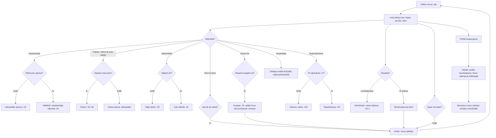

# Yöajo: one leg of the night drive

How one leg of Yöajo plays (v1, #181). The player drives at night up Valtatie 4 from Helsinki
to Rovaniemi, one leg a level, seen in 3D from behind the car. The car pulls up to speed by
itself; the player steers, brakes and switches the high beams. On the road come oncoming cars,
slow tractors, trucks and cars to overtake, walkers, reckless drivers, bad stretches, speed
cameras, moose (and reindeer in Lapland), rain and snow, and the driver grows sleepy.

## Colours

- **blue**: what the player sees and does
- **amber**: a check that decides the path
- **teal**: points for driving well
- **rose**: a penalty, or the end of the leg
- **green**: arriving, stars and records

## Boxes

- **Valitse osuus, Aja**: the menu (`menu()` in `games/yoajo/v1/ui.js`) lists the eight legs of `LEGS` in `game.js`, from Helsinki → Järvenpää to Oulu → Rovaniemi; a leg opens when the one before is driven (`maxLeg`, saved as `ai-pelit:yoajo:taso`). Each leg has its own weather (dry, rain, snow, blizzard) and its own mix of traffic. `newLeg()` builds the road (`makeRoad()`: bends and hills from the leg's seed), the speed limits and signs, and the list of what happens where (`events`).
- **Auto kiihtyy itse: ohjaa, jarruta, valot**: `drive()` in `game.js`. The car pulls up to 130 km/h unless JARRU is held; ◀ ▶ move it across the road, and a bend pushes it outwards, more the faster and the slipperier (`WEATHER[...].grip`). VALOT switches between low beams (42 m) and high beams (135 m), less in rain and snow; `view.js` draws them as one spot light, so what is beyond the beam stays dark. The buttons are drawn and read in `ui.js` (`driveButtons()`), held buttons by pointer.
- **Pitkät pois ajoissa?**: `lights()` in `game.js`. An oncoming car is released 620 m ahead; if the high beams were on when it came into sight and are off before it is 150 m away, +20. Still on at 150 m: −30 and it flashes its own at the player. A car ahead within 70 m dazzled for 1.5 s costs −20.
- **Ohitus +40..60**: `meet()`: passing a slow vehicle in the player's direction scores once (tractor 40, car 50, truck 60). Same-direction cars keep behind slower ones and behind the player.
- **Väljä ohitus +20**: walkers keep to the left edge facing traffic, or now and then the right edge; a third have no reflector and show only in the beam. Passing with under a metre of room above 40 km/h costs −40; touching one ends the leg as a near miss ("Vaaratilanne").
- **Jarrutit tai väistit?**: a moose (or a reindeer on the last leg) steps out of the forest about four seconds of driving ahead, after a warning sign; some stop on the road. Its eyes shine in the beam (`deerMesh()` in `view.js`).
- **Kuoppa -15, neljäs kova isku puhkaisee renkaan**: `holes()`: a bad stretch after an "Epätasainen tie" sign has potholes; below 50 km/h they do nothing, above it they jolt the car; the fourth hit above 70 km/h bursts a tyre.
- **Yli rajoituksen +5?**: `cameras()`: a camera stands 340 m after its sign; over the limit by more than 5 km/h it flashes and fines −150, otherwise +25.
- **Ohittaja omalla kaistalla: väistä pientareelle**: two kinds of reckless drivers (`move()`): one from behind with high beams on, overtaking when nobody comes and cutting in; one oncoming, pulling out from behind a truck into the player's lane with its high beams on.
- **Kahvitauko: vireys täyteen, +10 s**: `tiredness()` (#181 "Kuskia väsyttää"), from leg 3. Sleepiness grows with the road driven; past 40 % the eyes close for a moment now and then (black lids in `dashboard()`), longer as it grows. Stopping in the rest area's bay (a sign, then a paved bay and a lit kiosk on the right) wakes the driver; without a stop they fall asleep after the rest area, before the town.
- **Tähdet: perillä, tavoiteajassa, ilman sakkoja ja häikäisyjä**: `finish()`: one star for arriving, two within the target time (`parTime()`: the leg at the speed limits, at most 90 on snow, plus 20 %), three also with no fines, no dazzling and no close passes. Time under the target gives 10 points a second.
- **Seuraava osuus aukeaa, ennätys tuloslistalle**: stars and best points per leg are saved (`tahdet`, `pisteet`), and the furthest leg driven to the end as `ajettu` (`taso`, the furthest leg open, stops at 8). The points go to the leg's high-score list `osa-N` (`public/scores.js`, `server/api.js`), with `ajettu` shown beside them. `buildWorld()` and `dispose()` in `view.js` free the old leg's 3D pictures and the passed traffic, so driving leg after leg does not fill the phone's memory.
